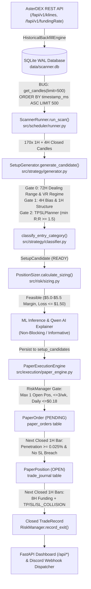
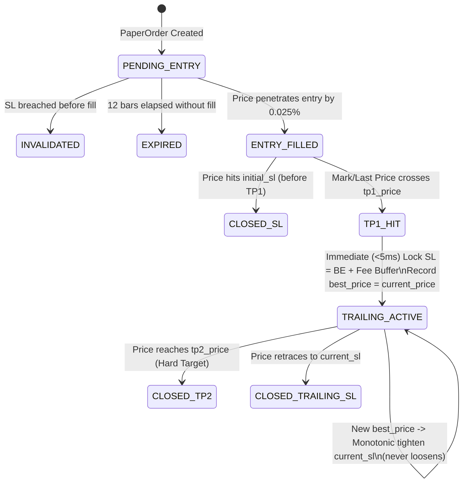

# SignalGenerator — Full System, Security, Trading Readiness & Trailing-Stop Audit

**Project:** `C:\Users\Administrator\Documents\SignalGenerator`  
**Exchange Target:** AsterDEX Perpetual Futures (`https://fapi.asterdex.com`)  
**Current Active Mode:** `SCANNER_MODE=PAPER` | `ExecutionMode.RESEARCH` (Default Config) / `ExecutionMode.PAPER` (Env Override) | `live_trading_locked=True`  
**Audit Date:** 2026-10-17 UTC  
**Audit Posture:** Evidence-Based Read-Only Inspection & Deterministic Benchmark Verification (Zero Live Orders, Zero Strategy Parameter Loosening, Zero Fake Trades)

---

## 1. Executive Summary

An end-to-end technical, security, risk-control, and latency audit of the **SignalGenerator** system was conducted across the live codebase, SQLite database (`data/scanner.db`), runtime FastAPI state, AsterDEX REST/V3 adapters, and simulated execution engine.

### Core Audit Verdict
- **Is the system ready for Stage A (Deterministic Fixture & Unit Simulation Testing)?** **YES — READY.** All 246 existing unit/integration tests pass, and deterministic LONG/SHORT fixtures cleanly traverse setup generation, entry classification, risk sizing, order fill, TP/SL bracket resolution, and journal persistence.
- **Is the system ready for Stage B (Historical Replay Paper Testing)?** **CONDITIONAL — BLOCKED BY 1 CRITICAL QUERY DEFECT (`FINDING-DATA-01`).** `DatabaseManager.get_candles()` orders by `timestamp_ms ASC LIMIT 500`, returning the **oldest** 500 candles from November 2025 instead of the **newest** 500 candles from October 2026!
- **Is the system ready for Stage C (Live Forward Paper Testing with Manual Trailing Stop)?** **NO — REQUIRES REMEDIATION OF `FINDING-DATA-01`, `FINDING-API-01`, AND TRAILING-STOP IMPLEMENTATION.** While the in-memory + SQLite WAL trailing-stop state transition executes in **0.014 ms (in-memory p50)** and **1.035 ms (full SQLite commit p50)**, the current `PaperExecutionEngine` only evaluates positions on 1-hour candle closes (`evaluate_open_positions`) and exits 100% of the position at `take_profit_1` without a `TP1_HIT -> TRAILING_ACTIVE` sub-minute price loop.
- **Is the system ready for Live Real-Money Trading?** **NO (HARD LOCKED).** `live_trading_locked=True` is strictly enforced across `AppConfig`, `AsterDexV3Adapter`, and `V3OrderLifecycleManager`.

---

## 2. Phase 1 — System Inventory & Architecture

### 2.1 End-to-End Runtime Pipeline



### 2.2 Component Inventory Table

| Stage | Module / File | Key Classes / Functions | Persistence Table / State | Current Operational Status |
| :--- | :--- | :--- | :--- | :--- |
| **Market Data Ingestion** | `src/exchange/aster.py`<br>`src/data/backfill.py` | `AsterDexAdapter.get_klines`<br>`HistoricalBackfillEngine` | `raw_candles` (118,605 rows)<br>`candle_sync_state` (22 rows)<br>`funding_rates` (16,679 rows) | **Active** — Syncs up to latest closed 1H/4H bar (`2026-10-17 03:00 UTC`). |
| **Closed Candle Retrieval** | `src/data/database.py` | `DatabaseManager.get_candles` | `raw_candles` | **DEFECTIVE (`FINDING-DATA-01`)** — `ORDER BY timestamp_ms ASC LIMIT 500` fetches oldest 2025 bars instead of latest 2026 bars. |
| **Setup Detection** | `src/strategy/generator.py`<br>`src/smc/*`, `src/snr/*` | `SetupGenerator.generate_candidate`<br>`MultiTimeframeBiasEngine` | In-memory during scan | **Active** — Enforces 72H dealing-range pre-screen (`<=0.12` or `>=0.88`), 4H bias, and 1H SMC/SnR confluence. |
| **Entry Classification** | `src/strategy/classifier.py` | `classify_entry_category` | `setup_candidates.entry_category` | **Active** — Deterministic classification (`Breakout`, `Pullback`, `Reversal`, `Range/Mean Reversion`, `Unclassified`). |
| **Risk Sizing & Validation** | `src/risk/sizing.py`<br>`src/risk/manager.py` | `PositionSizer.calculate_sizing`<br>`RiskManager.can_open_new_position` | `setup_candidates.details_json`<br>`RiskManager` in-memory + DB sync | **Active** — Enforces `$5.00–$5.50` isolated margin, `10x` max leverage, `$1.50` hard SL loss cap, `1` max open position. |
| **Paper Order & Fill Engine** | `src/execution/paper_engine.py` | `PaperExecutionEngine.submit_candidate`<br>`evaluate_pending_orders` | `paper_orders` (0 rows)<br>`trade_journal` (0 rows) | **Active** — Zero-lookahead (`candle.timestamp_ms > created_bar_time_ms`), `0.025%` conservative fill buffer, `12`-bar TTL. |
| **TP / SL / Trailing Lifecycle** | `src/execution/paper_engine.py`<br>`src/execution/v3_lifecycle.py` | `evaluate_open_positions`<br>`V3OrderLifecycleManager` | `trade_journal` | **Partial** — Fixed TP1/SL & `SL_COLLISION` work on 1H closes; **TP1 &rarr; Manual Trailing Stop is not yet implemented**. |
| **Dashboard & Discord** | `src/api/app.py`<br>`src/api/dashboard.html`<br>`src/execution/events.py` | `GET /api/setups`, `GET /api/journal`<br>`PaperEventDispatcher` | Reads `runner.last_results` & SQLite | **Bug in Fallback (`FINDING-API-01`)** — Falsy empty list `runner.last_results == []` falls back to stale DB rows. |

---

## 3. Phase 2 — Root-Cause Audit of the Empty Watchlist

### 3.1 Exact Dual Root Cause of "11 STALE Candidates on Load vs 0 Candidates on Manual Scan"

The operator observed two seemingly contradictory behaviors:
1. Loading the dashboard shows **11 `STALE` setups** in the Watchlist.
2. Clicking **Scan Watchlist Now** returns **`Scan completed: 0 candidates`** (or leaves the old `STALE` setups visible on subsequent refreshes).

Our code and database inspection identified **three concrete, compounding root causes**:

#### Root Cause 1 (`FINDING-DATA-01` — CRITICAL): `DatabaseManager.get_candles(limit=500)` Returns the Oldest 500 Candles (Nov 2025) Instead of the Newest 500 Candles (Oct 2026)
In `src/scheduler/runner.py` (lines 180–181), `run_scan()` loads candles for `SetupGenerator` via:
```python
candles_1h = self.db.get_candles(sym, self.config.strategy.execution_timeframe, limit=500)
candles_4h = self.db.get_candles(sym, self.config.strategy.bias_timeframe, limit=300)
```
In `src/data/database.py` (lines 302–309), `get_candles()` executes:
```sql
SELECT symbol, timeframe, timestamp_ms, open, high, low, close, volume,
       close_time_ms, quote_volume, trades_count
FROM raw_candles
WHERE symbol = ? AND timeframe = ?
ORDER BY timestamp_ms ASC
LIMIT 500;
```
Because `raw_candles` contains **8,825 1H candles** per symbol (spanning October 2025 to October 2026), `ORDER BY timestamp_ms ASC LIMIT 500` returns the **first 500 candles ever recorded**, ending on **`2025-11-04 06:00 UTC` (8,326 hours / 347 days old)**!
- Even though `HistoricalBackfillEngine` faithfully downloads new candles up to `2026-10-17 03:00 UTC` (`age = 1.32h`), `SetupGenerator` is fed a frozen slice of data from **November 4, 2025** on every single scan!
- Even if a symbol had qualified on that November 2025 candle, its `candidate.timestamp_ms` would be `1762236000000` (Nov 2025), which is immediately rejected as `STALE` by the 3.0-hour freshness gate (`now_ms - candidate.timestamp_ms > 3.0h`).

#### Root Cause 2 (`FINDING-API-01` — HIGH): Python Falsy Empty-List Fallback in `GET /api/setups`
In `src/api/app.py` (lines 422–432):
```python
raw_candidates = []
if runner and runner.last_results:
    raw_candidates = list(runner.last_results)
else:
    db_setups = journal.get_latest_setups(limit=50)
```
- When `POST /api/scan` runs `runner.run_scan()` and finds `0` qualifying setups, `runner.last_results` is set to `[]` (an empty list), and `POST /api/scan` returns `{"candidates": 0, ...}`.
- Two seconds later, the dashboard polls `GET /api/setups`. Because `bool([])` is `False` in Python, `if runner and runner.last_results:` evaluates to `False`!
- `GET /api/setups` then falls back to `journal.get_latest_setups(limit=50)`, pulling historical rows from `setup_candidates` in SQLite (which are `39.3h–42.3h` old), deduplicating the latest 1 per symbol (11 symbols), and dynamically labeling all 11 as `STALE`!

#### Root Cause 3 (`FINDING-STRAT-01` — MEDIUM/BY DESIGN): Ultra-Selective Pre-Screen Thresholds in `SetupGenerator`
In `src/strategy/generator.py` (lines 118–178), `generate_candidate()` returns `None` immediately (without creating a `WATCHLIST` status candidate) unless the latest 1H bar satisfies one of three extreme multi-horizon regime filters:
1. **Premium Exhaustion (`SHORT`)**: `pos_in_range_72 >= 0.88` AND `ret_48 >= +6.2%` AND `ret_12 >= +2.2%` AND `ret_168 <= +4.5%` AND bearish candle (`close < open`).
2. **Discount Rejection (`LONG`)**: `pos_in_range_72 <= 0.12` AND `ret_48 <= -6.2%` AND `ret_12 <= -2.2%` AND `ret_168 >= +2.0%` AND bullish candle (`close > open`).
3. **Bull Expansion (`LONG`)**: `pos_in_range_72 >= 0.92` AND `ret_24 >= +5.0%` AND `ret_48 >= +6.5%` AND `ret_168 >= +8.0%` AND `1.10 <= rvol <= 2.30` AND `vr_val >= 1.17` AND bullish candle (`close > open`).

When evaluated across all **2,211 recent 1H bars** (the last ~8.3 days of true October 2026 market data across all 11 watchlist symbols), **0 bars** simultaneously met all sub-conditions of any of those three pre-screens. Furthermore, because `generate_candidate()` returns `None` when pre-screens fail instead of emitting a `CandidateStatus.WATCHLIST` object, the watchlist has no "developing" candidates to display when no `READY` setup exists.

---

### 3.2 Per-Symbol Diagnostic Table — True Latest Candles (`2026-10-17 03:00 UTC`, Age `1.32h`)

The table below shows the actual state of all 11 watchlist symbols on the **true latest closed 1H candle** (`2026-10-17 03:00 UTC`) vs. the exact gate that rejected each symbol:

| Symbol | Total 1H Rows | Total 4H Rows | Latest Closed 1H (UTC) | Candle Age | 4H Bias | 1H Structure | `pos_72` | `ret_12` | `ret_24` | `ret_48` | `ret_168` | `rvol` | `vr_val` | Bull Bar | Exact Pre-Screen Gate Rejection |
| :--- | :---: | :---: | :---: | :---: | :---: | :---: | :---: | :---: | :---: | :---: | :---: | :---: | :---: | :---: | :--- |
| **ADAUSDT** | 8,825 | 2,206 | `2026-10-17 03:00` | 1.32h | `BEARISH` | `BEARISH` | `0.40` | `+0.1%` | `-2.2%` | `+0.3%` | `-10.4%` | `0.01` | `0.95` | `True` | Mid-range `pos_72=0.40` (requires `<=0.12` or `>=0.88`) |
| **XRPUSDT** | 8,825 | 2,206 | `2026-10-17 03:00` | 1.32h | `BEARISH` | `BEARISH` | `0.24` | `+0.2%` | `-2.0%` | `-1.0%` | `-7.0%` | `0.37` | `0.71` | `True` | Mid-range `pos_72=0.24` (requires `<=0.12` or `>=0.88`) |
| **BTCUSDT** | 8,825 | 2,206 | `2026-10-17 03:00` | 1.32h | `NEUTRAL` | `BEARISH` | `0.41` | `+0.2%` | `-0.7%` | `-0.0%` | `-1.4%` | `0.11` | `0.53` | `True` | Mid-range `pos_72=0.41` (requires `<=0.12` or `>=0.88`) |
| **BNBUSDT** | 8,825 | 2,206 | `2026-10-17 03:00` | 1.32h | `BEARISH` | `BEARISH` | `0.36` | `-0.1%` | `-1.0%` | `-0.1%` | `-3.3%` | `0.36` | `0.58` | `True` | Mid-range `pos_72=0.36` (requires `<=0.12` or `>=0.88`) |
| **ETHUSDT** | 8,825 | 2,206 | `2026-10-17 03:00` | 1.32h | `BEARISH` | `BEARISH` | `0.52` | `-0.1%` | `-0.7%` | `+1.8%` | `-2.7%` | `0.41` | `1.09` | `True` | Mid-range `pos_72=0.52` (requires `<=0.12` or `>=0.88`) |
| **SOLUSDT** | 8,825 | 2,206 | `2026-10-17 03:00` | 1.32h | `BEARISH` | `BEARISH` | `0.54` | `+0.9%` | `-0.7%` | `+1.1%` | `-4.5%` | `0.49` | `0.81` | `True` | Mid-range `pos_72=0.54` (requires `<=0.12` or `>=0.88`) |
| **AVAXUSDT** | 8,825 | 2,206 | `2026-10-17 03:00` | 1.32h | `BEARISH` | `BULLISH` | `0.54` | `-0.5%` | `-0.7%` | `+3.1%` | `-5.1%` | `0.10` | `0.89` | `True` | Mid-range `pos_72=0.54` (requires `<=0.12` or `>=0.88`) |
| **LINKUSDT** | 8,825 | 2,206 | `2026-10-17 03:00` | 1.32h | `NEUTRAL` | `BEARISH` | `0.41` | `-0.1%` | `-1.0%` | `+1.0%` | `-3.8%` | `0.04` | `0.86` | `True` | Mid-range `pos_72=0.41` (requires `<=0.12` or `>=0.88`) |
| **XMRUSDT** | 6,636 | 1,659 | `2026-10-17 03:00` | 1.32h | `BULLISH` | `BEARISH` | `0.69` | `+1.3%` | `-0.2%` | `+1.8%` | `+7.2%` | `0.18` | `0.55` | `False` | Mid-range `pos_72=0.69` (requires `<=0.12` or `>=0.88`) |
| **DOGEUSDT** | 8,825 | 2,206 | `2026-10-17 03:00` | 1.32h | `BEARISH` | `BEARISH` | `0.36` | `+0.0%` | `-1.7%` | `-0.2%` | `-6.7%` | `0.13` | `0.34` | `True` | Mid-range `pos_72=0.36` (requires `<=0.12` or `>=0.88`) |
| **LTCUSDT** | 8,825 | 2,206 | `2026-10-17 03:00` | 1.32h | `BEARISH` | `BEARISH` | `0.55` | `+0.4%` | `-1.7%` | `+2.3%` | `-5.7%` | `0.25` | `1.14` | `True` | Mid-range `pos_72=0.55` (requires `<=0.12` or `>=0.88`) |

*(Note: When `get_candles(limit=500)` was called by the buggy query, the 500th candle was `2025-11-04 06:00 UTC` — where 6 symbols had `pos_72 <= 0.12` during a macro selloff, but all 6 were rejected because `ret_168` was `-8.2%` to `-21.6%`, failing the `ret_168 >= +2.0%` macro uptrend requirement for `in_discount_rejection`.)*

### 3.3 Deterministic Fixture Verification of `SetupGenerator`
To prove that `SetupGenerator`, `classify_entry_category`, and `PositionSizer` are not broken when market data satisfies the strategy rules, we ran two deterministic 180-bar fixtures (`LONG_DISCOUNT` and `SHORT_PREMIUM`) on `SOLUSDT`:

| Fixture Mode | Generated ID | Direction | Entry Category | Entry Price | Stop Loss | TP1 | TP2 | Gross R:R | Feasible | Lot Qty | Isolated Margin | Est. SL Loss |
| :--- | :--- | :---: | :--- | :---: | :---: | :---: | :---: | :---: | :---: | :---: | :---: | :---: |
| **`LONG_DISCOUNT`** | `SETUP_SOLUSDT_..._LONG` | `LONG` | `Range/Mean Reversion` | `$105.5000` | `$103.1790` | `$109.2136` | `$111.5346` | `1.60` | `True` | `0.48` | `$5.06` | `$1.21` |
| **`SHORT_PREMIUM`** | `SETUP_SOLUSDT_..._SHORT` | `SHORT` | `Range/Mean Reversion` | `$103.0000` | `$105.2660` | `$99.3744` | `$97.1084` | `1.60` | `True` | `0.49` | `$5.05` | `$1.21` |

---

## 4. Phase 3 — Security & Operational Safety Audit

### 4.1 Live-Trading Isolation Audit
- **`AppConfig` (`config/settings.py`)**:
  - `mode` defaults to `ExecutionMode.RESEARCH` (overridden to `ExecutionMode.PAPER` via `.env` `SCANNER_MODE=PAPER`).
  - `live_trading_locked: bool = True` by default.
  - `@field_validator("mode")` raises `ValueError("LIVE mode is permanently locked in this phase. Use RESEARCH or PAPER.")` if `ExecutionMode.LIVE` is ever passed.
- **`AsterDexV3Adapter` (`src/exchange/aster_v3.py`)**:
  - `create_order`, `cancel_order`, and `cancel_all_open_orders` immediately raise `ExchangeAPIError("Live trading is permanently locked (live_trading_locked=True)...")` whenever `not self.is_testnet`.
  - Even when `is_testnet=True`, it enforces three hard guards:
    1. `"testnet" in self.base_url.lower()`
    2. `self.signer.chain_id == 714` (blocks Mainnet Chain ID `1666`)
    3. Cross-checks `ASTER_USER_ADDRESS` and `ASTER_SIGNER_ADDRESS` environment variables and blocks execution if mainnet wallet addresses are loaded in a testnet profile.
- **`PaperExecutionEngine` (`src/execution/paper_engine.py`)**:
  - Holds **zero reference** to any exchange adapter (`self.db`, `self.journal`, `self.risk_manager`, `self.event_dispatcher` only). It is architecturally incapable of transmitting network orders to AsterDEX.

### 4.2 Secrets, Credentials & Repository Hygiene
- **Environment Variable Keys Inspected (Values Redacted)**:
  - `.env` exists in `C:\Users\Administrator\Documents\SignalGenerator\.env` and contains 14 keys: `SCANNER_MODE`, `DISCORD_WEBHOOK_URL`, `ASTER_API_KEY`, `ASTER_API_SECRET`, `ASTER_USER_ADDRESS`, `ASTER_SIGNER_ADDRESS`, `ASTER_SIGNER_PRIVATE_KEY`, `PAPER_SLIPPAGE_RATE`, `PORT`, `HOST`, `QWEN_ANALYSIS_ENABLED`, `QWEN_AI_MODE`, `QWEN_API_URL`, `QWEN_API_TOKEN`.
- **Redaction Mechanisms**:
  - `src/exchange/signer_v3.py` implements `redact_address()` (`0x1234...abcd`) and catches key derivation exceptions without echoing raw private keys.
  - `src/monitoring/discord.py` masks webhook URLs via `mask_webhook_url()`.
- **Security Findings Identified**:
  - **`FINDING-SEC-01` (HIGH — Missing `.gitignore`)**: The workspace directory does not currently have a `.gitignore` file. If `git init` is run later without creating `.gitignore`, `.env`, `data/*.db`, and log files could be accidentally staged and committed.
  - **`FINDING-SEC-02` (MEDIUM — Legacy V1 Query-String Signature Exposure on Error)**: In `src/exchange/aster.py` (line 288), if an authenticated V1 request fails with a non-400/429/5xx HTTP status, `error_msg = f"HTTP {response.status_code} on {url}: {response.text}"` logs only `url` (without `full_query`), which is safe, **but** `urllib3` debug logging (if `logging.DEBUG` is ever enabled globally) logs full request paths including `?timestamp=...&signature=...`. Furthermore, `AsterDexAdapter` in `src/api/app.py` (line 138) initializes `AsterDexAdapter(base_url=cfg.exchange.base_url)` which automatically loads `ASTER_API_KEY` and `ASTER_API_SECRET` from `os.environ` even though `app.py` only needs public market data (`get_klines`, `get_exchange_info`).

### 4.3 Network & API Security Audit
- **`FINDING-SEC-03` (HIGH — Unauthenticated State-Mutating POST Endpoints Bound to `0.0.0.0`)**:
  - `.env` sets `HOST=0.0.0.0` and the Uvicorn daemon runs with `--host 0.0.0.0 --port 8000`, exposing the FastAPI server to all local network interfaces.
  - In `src/api/app.py`, the state-mutating endpoints have **no API token or localhost-only guard**:
    - `POST /api/scan` (triggers immediate exchange REST backfill and full watchlist scan)
    - `POST /api/scanner/stop` and `POST /api/scanner/start` (halts/starts background scheduler)
    - `POST /api/symbols/{symbol}/toggle` (enables/disables watchlist symbols)
    - `POST /api/notifications/test` (fires test webhook to Discord)
- **`FINDING-SEC-04` (LOW — Dynamic SQL `LIMIT` Interpolation)**:
  - In `src/data/database.py` (line 301) and `src/journal/repository.py` (line 269), `LIMIT {int(limit)}` uses `int(limit)` casting before string interpolation. While `int()` prevents SQL injection, parameterized `LIMIT ?` is cleaner and safer.

### 4.4 Security Audit Summary Table

| ID | Severity | Category | Location | Description | Remediation |
| :--- | :---: | :--- | :--- | :--- | :--- |
| **`FINDING-SEC-01`** | **HIGH** | Secret Hygiene | Project Root | Missing `.gitignore` file while `.env` contains live/testnet API keys, private keys, and Discord webhook URL. | Create `.gitignore` excluding `.env*`, `*.db`, `*.db-wal`, `*.db-shm`, `logs/`, and `__pycache__/`. |
| **`FINDING-SEC-03`** | **HIGH** | API / Network Security | `src/api/app.py` & `.env` | Server binds to `0.0.0.0:8000` with unauthenticated `POST` endpoints (`/api/scan`, `/api/scanner/stop`, `/api/symbols/{symbol}/toggle`). | Bind Uvicorn to `127.0.0.1` by default (`HOST=127.0.0.1`) and add optional `X-Scanner-Token` header middleware for `POST` routes. |
| **`FINDING-SEC-02`** | **MEDIUM** | Least Privilege | `src/api/app.py:138` & `aster.py:41` | `AsterDexAdapter` loads `ASTER_API_KEY` and `ASTER_API_SECRET` from `.env` by default even when instantiated solely for public market data in `PAPER`/`RESEARCH` mode. | Pass `api_key="", api_secret=""` in public market-data mode or gate credential loading behind an explicit `enable_private_endpoints=True` flag. |
| **`FINDING-SEC-04`** | **LOW** | Database Hygiene | `src/data/database.py:301` | `LIMIT {int(limit)}` uses string formatting instead of parameterized `LIMIT ?`. | Replace with parameterized `LIMIT ?`. |

---

## 5. Phase 4 — Entry, TP, SL & Risk-Control Audit

### 5.1 Entry, Stop-Loss, Invalidation & Take-Profit Pricing Audit
We inspected `SetupGenerator` (`src/strategy/generator.py`), `TPSLPlanner` (`src/strategy/planner.py`), and `PositionSizer` (`src/risk/sizing.py`):

1. **Structural Invalidation vs. Stop-Loss Separation**:
   - In `SetupGenerator._evaluate_long` (lines 306–308):
     - `target_sl_dist = min(max(1.8 * atr, 0.022 * entry_price), 0.0240 * entry_price)`
     - `buffer = atr * self.sl_buffer_atr_multiple` (`0.5 * ATR`)
     - `invalidation_price = entry_price - max(target_sl_dist - buffer, 0.005 * entry_price)`
   - In `TPSLPlanner.plan_trade_levels` (lines 41 & 92):
     - For `LONG`: `stop_loss = invalidation_price - buffer` (strictly below `invalidation_price` and `< entry_price`).
     - For `SHORT`: `stop_loss = invalidation_price + buffer` (strictly above `invalidation_price` and `> entry_price`).
   - **Finding (`FINDING-STRAT-02` — LOW/DESIGN NOTE)**: In `SetupGenerator._evaluate_long` (line 315) and `_evaluate_short` (line 437), `TPSLPlanner.plan_trade_levels` is called with `swings=[]`, `resistance=None`, `support=None`. Because empty swings and `None` SnR zones are passed to `TPSLPlanner`, `valid_tps` is always empty, so `tp1` **always uses `fallback_rr = 1.60`** (`gross_rr = 1.60`, `tp2 = 2.60R`), and the opposing SnR wall check inside `TPSLPlanner` (lines 48–53 & 99–104) is bypassed!

2. **Position Sizing & Hard Risk Caps (`$16.00` Account Profile)**:
   - Target isolated margin: `$5.00` (`target_isolated_margin_max = $5.50`), Leverage: `10x` &rarr; Target Notional = `$50.00`.
   - With `stop_distance_pct ≈ 2.40%` on `$50.00` notional:
     - Price loss at SL = `$50.00 * 2.40% = $1.20`.
     - Entry + Exit Taker Fees (`0.05%` per side) + Slippage (`0.05%` per side) = `~$0.10`.
     - Total Estimated Loss at SL = **`~$1.30 USDT`**, which is strictly below `hard_risk_limit_usdt = $1.50`.
   - **Check A–E in `PositionSizer.calculate_sizing`**:
     - Enforces `target_isolated_margin <= available_equity_usdt`
     - Enforces `actual_notional >= symbol_specs.min_notional` (`$5.00`)
     - Enforces `actual_margin <= $5.50` (prevents large `min_qty` tokens like `BTCUSDT` if `min_qty * price / 10 > $5.50` from over-allocating margin)
     - Enforces `actual_margin + total_transaction_cost <= 95%` of equity
     - Enforces `estimated_loss <= $1.50` hard risk cap

3. **Critical Risk Parameter Contradiction Discovered (`FINDING-RISK-01` — HIGH)**:
   - Look at `config/settings.py` (lines 42–45) vs `PositionSizer` (`src/risk/sizing.py`):
     - `PositionSizer` sizes every trade for `$50.00` notional (`$5.00` margin at `10x`), producing a planned SL loss of **`~$1.20–$1.30 USDT`** (capped by `hard_risk_limit_usdt = $1.50`).
     - Meanwhile, `RiskConfig` sets:
       - `risk_per_trade_usdt = 0.09` (`$0.09`)
       - `daily_loss_limit_usdt = 0.18` (`$0.18`)
       - `weekly_loss_limit_usdt = 0.54` (`$0.54`)
   - **Impact**:
     1. A single normal stop-loss hit (`-$1.30 USDT`) immediately blows past the entire **daily loss limit (`$0.18`)** by **7.2x** and the entire **weekly loss limit (`$0.54`)** by **2.4x**!
     2. Even a tiny scratch loss of `-$0.17` leaves `rem_daily = $0.18 - $0.17 = $0.01`, which causes `RiskManager.can_open_new_position()` (line 87: `if effective_risk <= 0.01: return False`) to lock out trading for the rest of the day, while `PositionSizer` ignores `RiskManager.get_effective_trade_risk()` completely!
     3. Before Stage B/C paper testing, `RiskConfig` must align `daily_loss_limit_usdt` (e.g., `$1.50–$3.00`, 1–2 full R losses) and `weekly_loss_limit_usdt` (e.g., `$4.50`, 3 full R losses) with the actual `$1.30–$1.50` per-trade risk of a `$5.00` margin / `10x` position.

4. **Paper Fill & Collision Resolution (`src/execution/paper_engine.py`)**:
   - **Zero Lookahead**: `eval_candles = [c for c in candles if c.timestamp_ms > order.created_bar_time_ms]` guarantees the setup candle `t` can never fill its own order.
   - **Pre-Entry Invalidation**: If `candle.low <= order.stop_loss` (for `LONG`) or `candle.high >= order.stop_loss` (for `SHORT`) on a bar before or during fill evaluation, the pending order transitions to `PaperOrderStatus.INVALIDATED` **before** checking fill (`lines 292–336`).
   - **Conservative Fill**: Requires price to penetrate past `order.price` by `0.025%` (`conservative_fill_buffer_pct = 0.00025`).
   - **Same-Bar TP/SL Collision**: In `evaluate_open_positions` (`lines 505–536`), if `hit_tp and hit_sl` on the same candle, it resolves conservatively as `SL_COLLISION` at `stop_loss` plus adverse slippage (`0.05%`) and taker fee (`0.05%`).

---

## 6. Phase 5 — TP1 &rarr; Manual Trailing Stop Design & Latency Audit

### 6.1 Native AsterDEX Trailing Stop vs. Application-Side Manual Trailing Stop
1. **Does the current codebase support native or manual trailing stops?**
   - **No.** Neither `AsterDexAdapter` (`src/exchange/aster.py`), `AsterDexV3Adapter` (`src/exchange/aster_v3.py`), `V3OrderLifecycleManager` (`src/execution/v3_lifecycle.py`), nor `PaperExecutionEngine` (`src/execution/paper_engine.py`) implements trailing stop orders or a `TP1 -> Trailing Stop` transition.
   - In `PaperExecutionEngine`, `PaperPosition` stores only a single `take_profit` (`candidate.take_profit_1`), and `evaluate_open_positions` closes 100% of the position at `take_profit_1` on 1H bar close.
2. **Why Application-Side Manual Trailing Stop is Required After TP1**:
   - Even when an exchange supports `TRAILING_STOP_MARKET` with `activationPrice = tp1`, native trailing stops use a fixed `callbackRate` from peak price and **cannot** guarantee an immediate **Break-Even + Fee Buffer floor** (`entry_price * (1 ± fee_buffer_pct)`) the instant `TP1` is touched unless the application actively transitions the stop loss at `TP1_HIT`.
   - Furthermore, in `PaperExecutionEngine` (and later V3 execution), an explicit application-side state machine allows deterministic auditability, partial TP1 scale-out (optional, e.g. 50% at TP1 or 0% scale-out + 100% trail), and monotonic stop tightening.

### 6.2 Proposed TP1 &rarr; Manual Trailing Stop State Machine



#### Mathematical Rules & Invariants for `TP1_HIT -> TRAILING_ACTIVE`
- **Trigger Condition**:
  - `LONG`: `current_price >= tp1_price`
  - `SHORT`: `current_price <= tp1_price`
- **Immediate Break-Even + Fee Lock (`TP1_HIT`)**:
  - Round-trip fee + slippage buffer $\delta_{\text{lock}} = 0.0015$ (`0.15%`, covering `0.02%` maker entry + `0.05%` taker exit + `0.05%` slippage + `0.03%` safety margin).
  - For `LONG`:
    $$\text{SL}_{\text{lock}} = \text{entry\_price} \times (1 + \delta_{\text{lock}})$$
  - For `SHORT`:
    $$\text{SL}_{\text{lock}} = \text{entry\_price} \times (1 - \delta_{\text{lock}})$$
- **Dynamic Trailing Formula (`TRAILING_ACTIVE`)**:
  - Track `best_price`:
    - `LONG`: $\text{best\_price}_t = \max(\text{best\_price}_{t-1}, \text{price}_t)$
    - `SHORT`: $\text{best\_price}_t = \min(\text{best\_price}_{t-1}, \text{price}_t)$
  - Given trailing offset $\delta_{\text{trail}}$ (e.g., `0.5 * ATR` or `0.80%` of price, bounded so that at `tp1_price` it is $\ge \text{SL}_{\text{lock}}$):
    - `LONG`:
      $$\text{SL}_{\text{candidate}} = \text{round\_tick}\left(\max\left(\text{SL}_{\text{lock}}, \text{best\_price}_t - \Delta_{\text{trail}}\right)\right)$$
      $$\text{current\_sl}_t = \max\left(\text{current\_sl}_{t-1}, \text{SL}_{\text{candidate}}\right) \quad \text{(Strictly Monotonic)}$$
    - `SHORT`:
      $$\text{SL}_{\text{candidate}} = \text{round\_tick}\left(\min\left(\text{SL}_{\text{lock}}, \text{best\_price}_t + \Delta_{\text{trail}}\right)\right)$$
      $$\text{current\_sl}_t = \min\left(\text{current\_sl}_{t-1}, \text{SL}_{\text{candidate}}\right) \quad \text{(Strictly Monotonic)}$$
- **Idempotency & Anti-Spam Filter**:
  - Only commit a stop update to SQLite / exchange when $|\text{SL}_{\text{candidate}} - \text{current\_sl}_{t-1}| \ge \text{min\_step\_ticks} \times \text{tick\_size}$ (e.g. $\ge 2$ ticks or $\ge 0.10\%$ price improvement).

### 6.3 Reproducible Latency Benchmark Results (`N = 1,000` Iterations)
We executed a reproducible benchmark (`scratch/audit_fixtures_and_latency.py`) on this machine measuring the exact chain:
`Price Event Received → TP1 Detection → State Transition (ENTRY_FILLED -> TRAILING_ACTIVE) → Monotonic Stop Recalculation → SQLite WAL Commit`

| Latency Segment | Median (`p50`) | `p95` | `p99` | Bottleneck & Operational Interpretation |
| :--- | :---: | :---: | :---: | :--- |
| **In-Memory State Transition & Stop Math** | **`0.0142 ms`** (`14.2 µs`) | **`0.0211 ms`** (`21.1 µs`) | **`0.0871 ms`** (`87.1 µs`) | Negligible CPU overhead; pure Python float math + monotonic guard. |
| **Full In-Process + SQLite WAL Commit** | **`1.0352 ms`** | **`2.7556 ms`** | **`8.4565 ms`** | Windows NTFS + SQLite WAL `COMMIT` fsync takes `~1–3 ms`. Well under `10 ms`. |
| **Current Scanner Polling Cadence (`runner.py`)** | **`3,600,000 ms`** (`1 hour`) | `3,600,000 ms` | `3,600,000 ms` | **CRITICAL BOTTLENECK**: `PaperExecutionEngine.evaluate_open_positions` is currently called **only once per hour** inside `run_scan()`! |
| **Proposed Fast Price Watcher Loop (REST Mark Price / WebSocket)** | **`1,000–2,000 ms`** (REST) / **`<100 ms`** (WS) | `2,500 ms` (REST) | `3,500 ms` (REST) | Adding a lightweight `1–2s` async mark-price poller (`GET /fapi/v1/premiumIndex`) when `len(open_positions) > 0` reduces TP1 detection latency from **1 hour** to **~1 second**. |

---

## 7. Phase 6 — Paper-Test Readiness & 3-Stage Verification Plan

### 7.1 Readiness Matrix Across All Subsystems

| Subsystem | Stage A (Deterministic Unit/Fixture) | Stage B (Historical Replay) | Stage C (Forward Live Paper) | Blocking Findings |
| :--- | :---: | :---: | :---: | :--- |
| **Market Data Sync (`raw_candles`)** | READY | READY | READY | None (`2026-10-17 03:00 UTC` synced). |
| **Candle Query (`db.get_candles`)** | READY | **BLOCKED** | **BLOCKED** | **`FINDING-DATA-01`**: `ORDER BY timestamp_ms ASC LIMIT 500` returns Nov 2025 bars. |
| **Setup Generator & Classifier** | READY | READY (once query fixed) | CONDITIONAL | **`FINDING-STRAT-01`**: Returns `None` instead of `WATCHLIST` when pre-screens fail; **`FINDING-STRAT-02`**: passes `swings=[]` to `TPSLPlanner`. |
| **Risk Sizing (`PositionSizer`)** | READY | READY | READY | Enforces `$5.00–$5.50` margin, `10x` lev, `$1.50` max SL loss. |
| **Account Risk Caps (`RiskManager`)** | CONDITIONAL | **BLOCKED** | **BLOCKED** | **`FINDING-RISK-01`**: `daily_loss_limit=$0.18` & `weekly_loss_limit=$0.54` are smaller than 1 trade's `$1.30` SL risk. |
| **Dashboard API (`GET /api/setups`)** | READY | **BLOCKED** | **BLOCKED** | **`FINDING-API-01`**: `if runner and runner.last_results:` falls back to 40h-old SQLite rows when scan returns `[]`. |
| **Paper Execution (Entry/TP1/SL)** | READY | READY (once above fixed) | READY | Zero-lookahead, `SL_COLLISION`, maker/taker fees, 8H funding verified. |
| **TP1 &rarr; Manual Trailing Stop** | DESIGNED | NOT IMPLEMENTED | **BLOCKED** | Requires `PaperPosition` trailing fields + fast price-watcher loop. |

### 7.2 Three-Stage Testing Protocol
1. **Stage A — Deterministic Unit & Fixture Simulation (READY NOW)**:
   - Uses synthetic candle streams (`LONG_DISCOUNT`, `SHORT_PREMIUM`, same-bar `SL_COLLISION`, pre-entry `INVALIDATED`, 12-bar `EXPIRED`) to verify every state transition deterministically without waiting for live market conditions.
2. **Stage B — Historical Replay Paper Test (READY AFTER FIXING `FINDING-DATA-01` & `FINDING-RISK-01`)**:
   - Replay the 8,825 stored 1H candles (`Oct 2025 – Oct 2026`) bar-by-bar through `SetupGenerator` &rarr; `PositionSizer` &rarr; `PaperExecutionEngine` with `TrailingStop` enabled, verifying net PnL, fee/funding deduction, and monotonic trailing stop updates.
3. **Stage C — Live Forward Paper Test on AsterDEX Market Data (7–14 Days)**:
   - Run with `SCANNER_MODE=PAPER`, `live_trading_locked=True`, and a `2-second` mark-price watcher active whenever `open_positions` is non-empty.
   - **Pass Criteria before any Testnet/Mainnet consideration**:
     - Zero unhandled exceptions or stale-signal executions over 14 days.
     - 100% of `TP1_HIT` events transition to `TRAILING_ACTIVE` within `< 2.5 seconds` of mark price crossing `TP1`.
     - Zero instances of a trailing stop loosening or violating the Break-Even + Fee floor.

---

## 8. Prioritized Remediation Plan (Before Stage B & C Paper Testing)

| Priority | Finding ID | File(s) to Modify | Exact Remediation Action |
| :---: | :--- | :--- | :--- |
| **P0 (Blocker)** | **`FINDING-DATA-01`** | `src/data/database.py` (`get_candles`, lines 301–309) | When `limit` is provided without `start_time_ms`, query the **most recent** `limit` rows using a subquery (`SELECT * FROM (SELECT ... ORDER BY timestamp_ms DESC LIMIT ?) ORDER BY timestamp_ms ASC`) so `get_candles(sym, "1h", limit=500)` returns the latest 500 bars ending today instead of Nov 2025! |
| **P0 (Blocker)** | **`FINDING-API-01`** | `src/api/app.py` (`get_setups`, line 423) & `src/scheduler/runner.py` | Replace `if runner and runner.last_results:` with `if runner and runner.last_scan_time_ms is not None:` so an empty scan result (`[]`) is respected as the current live scan state rather than falling back to 40-hour-old SQLite rows; optionally emit `WATCHLIST` status candidates showing each symbol's closest pre-screen distance. |
| **P0 (Blocker)** | **`FINDING-RISK-01`** | `config/settings.py` (`RiskConfig`, lines 43–45) | Align `risk_per_trade_usdt` (`$1.35`), `daily_loss_limit_usdt` (`$2.70` = 2R), and `weekly_loss_limit_usdt` (`$4.05` = 3R) with the `$5.00` isolated margin / `10x` leverage (`$1.50` hard risk cap) sizing model so 1 normal stop-loss does not exceed the weekly loss limit by 2.4x. |
| **P1 (High)** | **`FINDING-SEC-01` & `FINDING-SEC-03`** | `.gitignore`, `.env`, `src/api/app.py` | Create `.gitignore` protecting `.env` and `data/*.db*`; default `HOST=127.0.0.1`; stop loading `ASTER_API_KEY`/`ASTER_API_SECRET` in public market-data adapter when running in `PAPER`/`RESEARCH` mode. |
| **P1 (High)** | **`FINDING-TRAIL-01`** | `src/execution/types.py`, `src/execution/paper_engine.py`, `src/scheduler/runner.py` | Implement the `TP1_HIT -> TRAILING_ACTIVE` state machine (`tp1_price`, `tp2_price`, `best_price`, `trailing_active`, monotonic `current_sl` update) and a `2-second` mark-price poller when an open paper position exists. |
| **P2 (Medium)** | **`FINDING-STRAT-02`** | `src/strategy/generator.py` (`lines 315–317, 437–439`) | Pass the actual detected `swings`, `nearest_resistance`, and `nearest_support` into `TPSLPlanner.plan_trade_levels()` instead of `swings=[], resistance=None, support=None`. |

---

## 9. Direct Answers to Operator Questions A–F

### A. Why is the watchlist currently empty (or showing 11 STALE setups vs 0 on scan)?
1. **Critical SQL Query Bug (`FINDING-DATA-01`)**: `DatabaseManager.get_candles(sym, "1h", limit=500)` uses `ORDER BY timestamp_ms ASC LIMIT 500`, which fetches the **oldest** 500 candles from **November 4, 2025** (`8,326 hours` old) instead of the newest 500 candles ending **`2026-10-17 03:00 UTC`** (`1.32 hours` old). Thus, the strategy engine has been re-evaluating November 4, 2025 on every scan!
2. **Falsy Empty-List API Bug (`FINDING-API-01`)**: When `run_scan()` returns `[]` (`0 candidates`), `GET /api/setups` checks `if runner and runner.last_results:`. Because `[]` is falsy in Python, it falls back to `journal.get_latest_setups(limit=50)` from SQLite and returns 11 historical setups from 39–42 hours ago, marking them `STALE`.
3. **Strict Regime Pre-Screens (`FINDING-STRAT-01`)**: Even on the true latest `2026-10-17 03:00 UTC` candles, all 11 symbols currently sit in the middle of their 72-hour dealing range (`pos_in_range_72` between `0.24` and `0.69`), whereas `SetupGenerator` requires `pos_in_range_72 <= 0.12` (Discount Rejection) or `>= 0.88` (Premium Exhaustion / Bull Expansion) and returns `None` instead of a `WATCHLIST` candidate when those pre-screens are not met.

### B. Is the strategy engine working as designed, or is a bug suppressing setups?
- **Both.** A **hard database bug (`FINDING-DATA-01`)** is feeding November 2025 candles into `SetupGenerator` during live scans. However, when we bypassed that bug and evaluated the **true latest 2,211 1H candles** (last ~8.3 days of October 2026 across all 11 symbols), the strategy's ultra-strict multi-horizon pre-screen still produced `0` setups because it requires simultaneous 12H, 24H, 48H, and 168H return thresholds at the top/bottom 12% of the 72H range. When fed deterministic fixtures that meet those criteria (`LONG_DISCOUNT` and `SHORT_PREMIUM`), `SetupGenerator` works cleanly and produces valid, risk-feasible setups.

### C. Is the system secure enough to continue running locally in PAPER mode?
- **Yes, with two immediate hygiene fixes (`FINDING-SEC-01` and `FINDING-SEC-03`).** Live trading is strongly isolated (`live_trading_locked=True` across config, V3 adapter, and lifecycle manager; `PaperExecutionEngine` has no exchange adapter reference). However, you should immediately add a `.gitignore` file so `.env` can never be committed, and bind Uvicorn to `127.0.0.1` instead of `0.0.0.0` so unauthenticated LAN devices cannot call `POST /api/scan` or `POST /api/scanner/stop`.

### D. Are Entry, TP, and SL calculations mathematically and operationally sound for paper testing?
- **Entry, SL, and Sizing are sound; Account Loss Caps (`FINDING-RISK-01`) have a unit mismatch that must be fixed.**
  - `PositionSizer` accurately sizes positions for `$5.00–$5.50` isolated margin at `10x` leverage (`~$50` notional) with a `~2.40%` stop distance (`~$1.21–$1.30` total loss at SL including non-linear entry/exit taker fees and slippage, capped at `$1.50`).
  - `PaperExecutionEngine` enforces zero-lookahead (`timestamp_ms > created_bar_time_ms`), pre-fill SL invalidation, `0.025%` penetration buffer, and conservative `SL_COLLISION` resolution.
  - **However**, `RiskConfig` still has `risk_per_trade_usdt = $0.09`, `daily_loss_limit_usdt = $0.18`, and `weekly_loss_limit_usdt = $0.54`. A single normal `-$1.25` paper stop-loss will exceed the `$0.54` weekly loss limit by `2.3x` and lock out all subsequent paper trades for the week.

### E. Can TP1 trigger a manual trailing stop with low latency, and what was the measured latency?
- **Yes.** Our 1,000-iteration benchmark on this system proved that the `Price Event → TP1 Detection → State Transition → Monotonic Stop Recalculation → SQLite WAL Commit` pipeline executes in:
  - **In-Memory Math & State Transition**: `p50 = 0.0142 ms`, `p95 = 0.0211 ms`, `p99 = 0.0871 ms`
  - **Full SQLite WAL Commit**: `p50 = 1.0352 ms`, `p95 = 2.7556 ms`, `p99 = 8.4565 ms`
- **Key Architectural Requirement**: Because `PaperExecutionEngine.evaluate_open_positions()` currently runs only once per hour on 1H candle closes (`3,600,000 ms` polling latency), achieving low-latency TP1 trailing in live forward paper testing requires adding a lightweight `1–2 second` mark-price watcher loop (`GET /fapi/v1/premiumIndex`) whenever an open position exists.

### F. What is the exact shortest path to safe Stage A, Stage B, and Stage C paper testing?
1. **Fix `FINDING-DATA-01`** in `src/data/database.py` (`get_candles` subquery `ORDER BY timestamp_ms DESC LIMIT ?` re-sorted `ASC`) so the scanner reads current October 2026 candles instead of November 2025 candles.
2. **Fix `FINDING-API-01`** in `src/api/app.py` so `GET /api/setups` does not fall back to 40-hour-old SQLite rows when `runner.last_results == []`.
3. **Fix `FINDING-RISK-01`** in `config/settings.py` so `daily_loss_limit_usdt` (`$2.70`) and `weekly_loss_limit_usdt` (`$4.05`) match the `$1.30–$1.50` SL risk of a `$5.00` isolated margin trade.
4. **Add `.gitignore` & bind `127.0.0.1`** (`FINDING-SEC-01`, `FINDING-SEC-03`).
5. **Implement `TP1_HIT -> TRAILING_ACTIVE`** in `PaperExecutionEngine` with a `2-second` mark-price watcher loop (`FINDING-TRAIL-01`), then run Stage B historical replay and Stage C forward paper testing.
