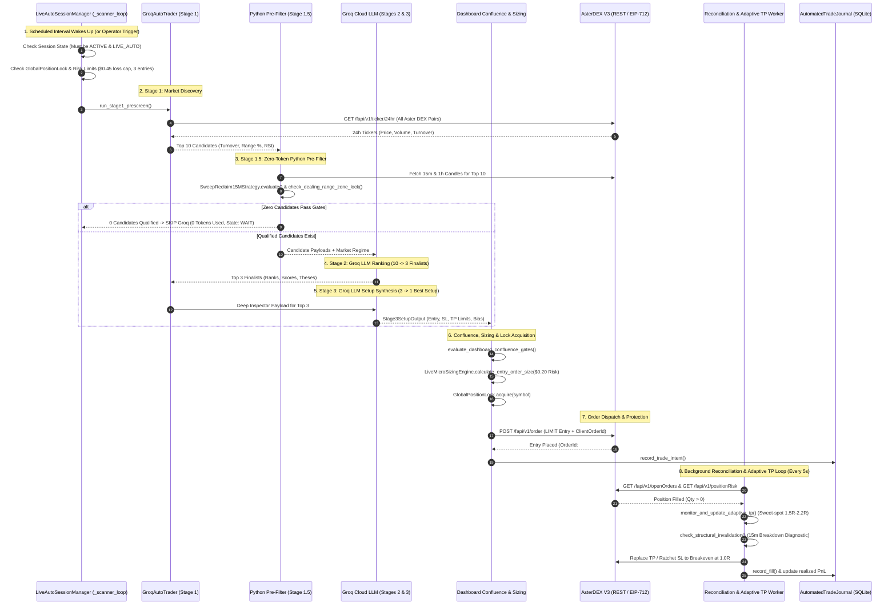
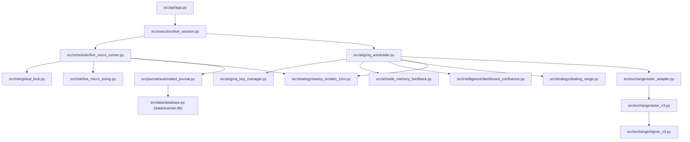

# Groq AI Auto-Hunter — Complete Architecture & Dependency Blueprint

> **Canonical Archive Copy:** [`data_penting/GROQ_AUTO_HUNTER_BLUEPRINT.md`](file:///c:/Users/Administrator/Documents/SignalGenerator/data_penting/GROQ_AUTO_HUNTER_BLUEPRINT.md)  
> **Repository:** `SignalGenerator`  
> **Strategy Core:** `15M_SWEEP_RECLAIM_SMC`  
> **AI Reasoning Engine:** Groq Cloud API (`qwen/qwen3.8-27b`) with 3-Key Rotation  
> **Target Exchange:** AsterDEX Perpetual Futures V3 (Web3 EIP-712 Signing)  
> **Execution Environment:** Python 3.13 + FastAPI + Uvicorn  

---

## 1. End-to-End Workflow Architecture Diagram

---

## 2. Granular 12-Stage Architecture Specification

### Stage 1: Session Lifecycle & Scanner Scheduling
- **Implementation:** [`src/execution/live_session.py:LiveAutoSessionManager._scanner_loop`](file:///c:/Users/Administrator/Documents/SignalGenerator/src/execution/live_session.py#L827)
- **Callers:** Background daemon thread started via `start_session()` or `start_scanner()`.
- **Callees:** `check_risk_limits()`, `GroqAutoTrader.run_full_pipeline()`.
- **Inputs:** `SessionConfig`, active `ExecutionMode` (`LIVE_AUTO` or `PAPER`).
- **Outputs:** Managed scan iteration; updates `_last_scan_utc`, `_cycle_status`.
- **State Read:** `self.is_authorized_and_active()`, `self.coordinator.global_lock.is_locked`.
- **State Mutated:** `self._cycle_telemetry`, `self.orders_placed_count`.
- **External Dependencies:** None (Internal threading).
- **Persistence:** Serializes session state to SQLite / memory via `_persist_state()`.
- **Error Handling:** Unhandled exceptions caught, logged as critical, session remains halted if fatal.
- **Tests:** `tests/test_live_auto_session.py`, `tests/test_live_session_lifecycle.py`.
- **Live Invariant:** Live execution is strictly blocked unless `state == LiveSessionState.ACTIVE` and `is_authorized_and_active == True`.

### Stage 2: Market Discovery & Deterministic Screener
- **Implementation:** [`src/ai/groq_autotrader.py:GroqAutoTrader.run_stage1_prescreen`](file:///c:/Users/Administrator/Documents/SignalGenerator/src/ai/groq_autotrader.py)
- **Callers:** `run_full_pipeline()`, `POST /api/scan`, `POST /api/inspector/groq-auto-setup`.
- **Callees:** `AsterAdapter.get_all_tickers()`, `compute_coin_metrics()`.
- **Inputs:** Raw 24h ticker metrics across all AsterDEX USDT pairs.
- **Outputs:** `Stage1Result` containing `Top10CandidateItem` list and market regime metrics.
- **State Read:** Public market prices, 24h volume, 72h high/low.
- **State Mutated:** Stage 1 candidate cache.
- **External Dependencies:** AsterDEX Public REST `GET /fapi/v1/ticker/24hr`.
- **Persistence:** Stored in candidate history table (`autotrader_screening_history`).
- **Error Handling:** Retries 3 times; falls back to cached ticker snapshots on network timeout.
- **Tests:** `tests/test_screener_ai_top3.py`, `tests/test_groq_autotrader.py`.

### Stage 3: Zero-Token Deterministic Python Pre-Filter
- **Implementation:** [`src/ai/groq_autotrader.py:GroqAutoTrader.prefilter_candidates_with_python_gates`](file:///c:/Users/Administrator/Documents/SignalGenerator/src/ai/groq_autotrader.py#L2390)
- **Callers:** `run_full_pipeline()`.
- **Callees:** `SweepReclaim15MStrategy.evaluate()`, `check_dealing_range_zone_lock()`.
- **Inputs:** Top 10 candidate items from Stage 1 + 15m and 1h closed candle bars.
- **Outputs:** `qualified_candidates` (filtered subset) and `per_coin_gate_reasons` dict.
- **Gate Rules:**
  1. *Dealing Range Zone Lock:* Longs strictly rejected in Premium ($\ge 65\%$) or Equilibrium ($38\%-65\%$). Shorts strictly rejected in Discount ($\le 38\%$).
  2. *SMC Trigger:* Must exhibit valid 15m wick sweep and body reclaim of prior structural swing.
- **Token Optimization:** **If 0 candidates qualify, the entire Groq LLM pipeline is skipped (0 tokens burned)**.
- **Error Handling:** Individual symbol candle fetch errors log a veto reason (`DATA_UNAVAILABLE`) and safely exclude the coin without crashing the cycle.
- **Tests:** `tests/test_zero_token_prefilter_and_cache.py`, `tests/test_dealing_range_and_sweep_smc.py`.

### Stage 4: Groq Candidate Ranking (10 -> 3 Finalists)
- **Implementation:** [`src/ai/groq_autotrader.py:GroqAutoTrader.run_stage2_ranker`](file:///c:/Users/Administrator/Documents/SignalGenerator/src/ai/groq_autotrader.py)
- **Callers:** `run_full_pipeline()`.
- **Callees:** `GroqKeyManager.call_with_fallback()`, `GroqClient.chat.completions.create`.
- **Inputs:** Qualified candidate metrics, BTC regime, multi-timeframe RSI, and orderbook spread.
- **Outputs:** `Stage2Result` containing `top_3` `Stage2FinalistItem` (ranks 1–3, scores, theses).
- **Prompt Structure:** Compact JSON-mode system prompt instructing qualitative ranking and setup thesis generation.
- **Model:** `qwen/qwen3.8-27b`.
- **Fallback Behavior:** If all 3 Groq API keys return 429/413 quota exhaustion, the system automatically triggers `python_prefilter` fallback ranking based on turnover and range position without failing the trade cycle.
- **Tests:** `tests/test_groq_autotrader.py`, `tests/test_groq_key_manager.py`.

### Stage 5: Deep Setup Inspection (3 -> 1 Best Setup)
- **Implementation:** [`src/ai/groq_autotrader.py:GroqAutoTrader.run_stage3_inspector`](file:///c:/Users/Administrator/Documents/SignalGenerator/src/ai/groq_autotrader.py)
- **Callers:** `run_full_pipeline()`.
- **Callees:** `build_qwen_dashboard_prompt_block()`, `CoinInspectorService.inspect_coin()`.
- **Inputs:** Stage 2 top candidate, orderbook depth, L2 walls, funding rate, liquidation clusters.
- **Outputs:** `Stage3SetupOutput` (`decision`: `EXECUTE`/`WAIT`, `entry_price`, `stop_loss_price`, `take_profit_price`, `qty`).
- **Prompt Safeguard:** Enforces JSON schema output; all suggested prices must adhere to exchange tick size precision.
- **Tests:** `tests/test_coin_inspector_api.py`, `tests/test_dashboard_confluence.py`.

### Stage 6: Key Rotation, Fallback & Failure Recovery
- **Implementation:** [`src/ai/groq_key_manager.py:GroqKeyManager`](file:///c:/Users/Administrator/Documents/SignalGenerator/src/ai/groq_key_manager.py)
- **Managed Keys:** `PRIMARY` (`GROQ_API_KEY`), `FALLBACK_A` (`GROQ_API_KEY_FALLBACK_A`), `FALLBACK_B` (`GROQ_API_KEY_FALLBACK_B`).
- **Invariants:**
  1. Thread-safe key index incrementing upon HTTP 429 (Rate Limit) or 503 (Service Unavailable).
  2. Automatic cooldown timer tracking key recovery time.
  3. Never log or leak raw API key strings in exceptions or stdout.
- **Tests:** `tests/test_groq_key_manager.py`.

### Stage 7: Candidate Confluence & Trade Memory Gates
- **Implementation:** [`src/intelligence/dashboard_confluence.py:evaluate_dashboard_confluence_gates`](file:///c:/Users/Administrator/Documents/SignalGenerator/src/intelligence/dashboard_confluence.py) & [`src/ai/trade_memory_feedback.py:TradeMemoryFeedbackEngine`](file:///c:/Users/Administrator/Documents/SignalGenerator/src/ai/trade_memory_feedback.py)
- **Checks:**
  1. *Streak Circuit Breaker:* 2 consecutive losses trigger a mandatory 60-minute cooling-off window.
  2. *Revenge Lock:* Blocks immediate re-entry on the same symbol unless entry is $\ge 1.20\%$ deeper into discount.
  3. *Stop-Loss Floor:* Enforces minimum stop distance $\ge 1.15\%$ to prevent fee bleed on tight market noise.
- **Outputs:** `ConfluenceGateResult` (`passed`: bool, `rejection_reason`: str).
- **Tests:** `tests/test_trade_memory_feedback.py`, `tests/test_dashboard_confluence.py`.

### Stage 8: Sizing, Risk Gates, Global Lock & Daily Limits
- **Implementation:** [`src/risk/live_micro_sizing.py:LiveMicroSizingEngine`](file:///c:/Users/Administrator/Documents/SignalGenerator/src/risk/live_micro_sizing.py) & [`src/risk/global_lock.py:GlobalPositionLock`](file:///c:/Users/Administrator/Documents/SignalGenerator/src/risk/global_lock.py)
- **Risk Invariants:**
  1. *Fixed Dollar Risk:* Risk per trade strictly capped at **$0.20 USDT**.
  2. *Margin Clamping:* Target isolated margin between $1.00 and $1.50 USDT (leverage 10x isolated).
  3. *Daily Loss Cap:* If daily accumulated loss reaches **$0.45 USDT** (evaluated in local WIB UTC+7), scanner halts.
  4. *Daily Placement Cap:* Max **3 filled entries** per daily session.
  5. *Global Position Lock:* Enforces **maximum 1 concurrent open position** across the entire bot.
- **Tests:** `tests/test_tier1_risk_policy.py`, `tests/test_live_lock_reconciliation.py`.

### Stage 9: Order Submission & Protective Order Creation
- **Implementation:** [`src/exchange/aster_v3.py:AsterDexV3Adapter.create_order`](file:///c:/Users/Administrator/Documents/SignalGenerator/src/exchange/aster_v3.py)
- **Callers:** `GroqAutoTrader.dispatch_live_order()`.
- **Protocol:** REST API over HTTPS signed using Web3 EIP-712 typed data signature (`src/exchange/signer_v3.py`).
- **Order Structure:**
  - Entry: `LIMIT` order (Post-Only where supported).
  - Stop Loss: `STOP_MARKET` or `STOP` placed immediately upon fill confirmation.
  - Take Profit: `LIMIT` order with `reduceOnly: True`.
- **Invariants:** Sibling cancellation guarantees that if TP fills, SL is cancelled; if SL fills, TP is cancelled.
- **Tests:** `tests/test_exchange_tp_bracket.py`, `tests/test_v3_order_lifecycle.py`.

### Stage 10: Position Monitoring, Adaptive TP & Invalidation
- **Implementation:** [`src/scheduler/live_micro_runner.py:LiveMicroCoordinator.monitor_and_update_adaptive_tp`](file:///c:/Users/Administrator/Documents/SignalGenerator/src/scheduler/live_micro_runner.py#L577) & `check_structural_invalidation`
- **Callers:** `LiveAutoSessionManager._run_reconciliation_once()`.
- **Adaptive TP Logic:**
  - Periodically gathers fresh 15m/1h resistance levels and L2 ask walls.
  - Front-runs nearest structural resistance within the **sweet spot [1.50R, 2.20R]**.
  - Minimum replacement threshold: **0.3% price difference** (prevents unnecessary order churn).
  - Consolidated duplicate order hygiene: cancels orphaned/disparate TP orders without touching SL or unrelated limit orders.
  - Breakeven Protection: Automatically moves SL to entry once position reaches **+1.0R** unrealized profit.
- **Tests:** `tests/test_adaptive_tp_and_structural_invalidation.py`, `tests/test_dynamic_structural_tp.py`.

### Stage 11: Exchange Reconciliation & Trade Journal Persistence
- **Implementation:** [`src/journal/automated_journal.py:AutomatedTradeJournal.reconcile_with_exchange`](file:///c:/Users/Administrator/Documents/SignalGenerator/src/journal/automated_journal.py#L422)
- **Callers:** Background reconciliation worker (`_reconciliation_loop()`).
- **Responsibilities:**
  1. Queries remote exchange positions and open orders.
  2. Aggregates executed fills, actual maker/taker fees, realized slippage, and 8h funding fees.
  3. Computes net realized PnL and realized R:R based on planned risk.
  4. Records closed trades into `automated_trades` table in `data/scanner.db`.
- **Tests:** `tests/test_automated_trade_journal.py`, `tests/test_unified_trade_journal_ui.py`.

### Stage 12: Telemetry, Alerts, Audit Logging & Recovery
- **Implementation:** [`src/scheduler/scanner_telemetry.py`](file:///c:/Users/Administrator/Documents/SignalGenerator/src/scheduler/scanner_telemetry.py), [`src/alerts/discord.py`](file:///c:/Users/Administrator/Documents/SignalGenerator/src/alerts/discord.py)
- **Features:**
  - Real-time cycle telemetry: stage elapsed duration, candle age, symbols attempted, last error.
  - Discord webhook dispatch for entry fills, TP hits, SL triggers, and daily loss limit breaches.
  - Daemon restart recovery: recovers active session state, audits orphan orders, and asserts that trading remains locked until explicit operator confirmation.
- **Tests:** `tests/test_cycle_telemetry.py`, `tests/test_discord_monitoring.py`.

---

## 3. Module Dependency Graph

---

## 4. Protected Components Inventory (Immutable During Desktop Migration)

The following 15 modules constitute the core trading engine and **MUST NOT be modified, renamed, moved, or deleted** during any frontend or desktop migration:

| Component Name | Relative File Path | Strict Responsibility |
| :--- | :--- | :--- |
| **`GroqAutoTrader`** | `src/ai/groq_autotrader.py` | 10 -> 3 -> 1 funnel screener, LLM ranking, and auto-dispatch pipeline |
| **`GroqKeyManager`** | `src/ai/groq_key_manager.py` | Thread-safe 3-key rotation and 429 quota failover |
| **`TradeMemoryFeedbackEngine`**| `src/ai/trade_memory_feedback.py`| Streak circuit breaker, revenge locks, and loss autopsy feedback |
| **`LiveAutoSessionManager`** | `src/execution/live_session.py` | Master session state machine, kill switch, and background loops |
| **`LiveMicroCoordinator`** | `src/scheduler/live_micro_runner.py`| Adaptive TP refresh, structural invalidation, risk limit checks |
| **`GlobalPositionLock`** | `src/risk/global_lock.py` | Process singleton enforcing max 1 concurrent live position |
| **`LiveMicroSizingEngine`** | `src/risk/live_micro_sizing.py` | $0.20 fixed dollar risk sizing, tick normalization, fee buffer |
| **`SweepReclaim15MStrategy`**| `src/strategy/sweep_reclaim_15m.py` | Approved production strategy: 15m sweep reclaim & dynamic TP |
| **`DealingRange`** | `src/strategy/dealing_range.py` | 72h Dealing range calculation and directional zone locks |
| **`DashboardConfluence`** | `src/intelligence/dashboard_confluence.py`| Web intelligence confluence gates and prompt synthesis |
| **`CoinInspectorService`** | `src/intelligence/coin_inspector.py`| L2 orderbook analysis, spread evaluation, dynamic precision |
| **`AutomatedTradeJournal`** | `src/journal/automated_journal.py` | Exchange fill reconciliation, PnL ledger, realized R tracking |
| **`AsterDexV3Adapter`** | `src/exchange/aster_v3.py` | AsterDEX V3 REST adapter, order brackets, position queries |
| **`SignerV3`** | `src/exchange/signer_v3.py` | Web3 EIP-712 payload cryptographic signer |
| **`DatabaseManager`** | `src/data/database.py` | SQLite WAL connection manager and schema migrations |
