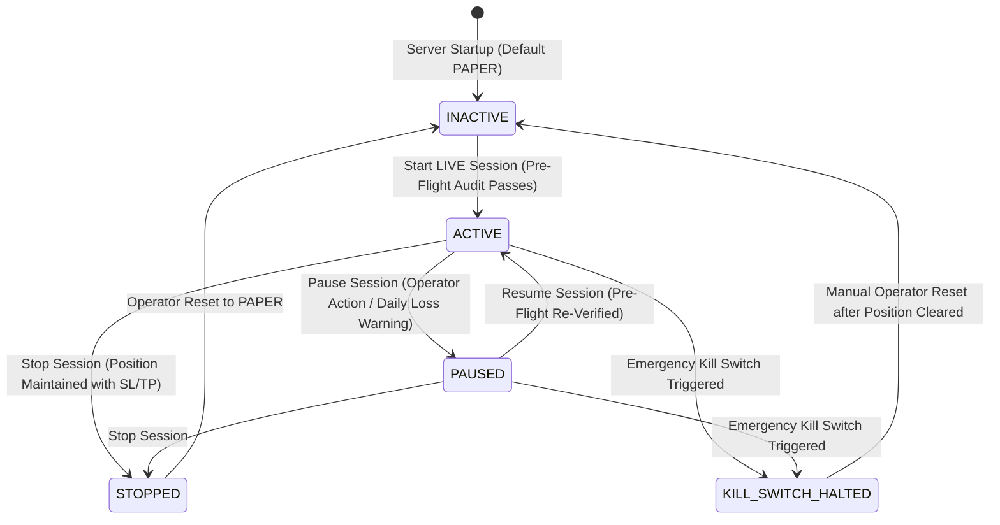

# LIVE AUTO-EXECUTION OPERATOR RUNBOOK
**Groq AI Auto-Hunter (`qwen/qwen3.8-27b`) • Aster DEX Mainnet**
*Version: LIVE_MICRO_V1-AUTO • Architecture Invariant Preserved*

---

## 1. Executive Summary & Core Principle

The **Groq AI Auto-Hunter (10 &rarr; 3 &rarr; 1)** now supports **Session-Authorized LIVE Auto-Execution (`LIVE_AUTO`)** on Aster DEX Mainnet.

> [!IMPORTANT]
> **Safety Invariant:** `LIVE_AUTO` is **NEVER** active by default. Every server start or process restart defaults strictly to `PAPER` mode with session state `INACTIVE`. Automatic order execution on Aster DEX Mainnet requires explicit operator authorization via a 10-point pre-flight safety audit.

---

## 2. Server-Controlled Execution Modes

| Mode | Description | Order Placement Behavior | Risk Gate Cap |
|---|---|---|---|
| **`PAPER`** *(Default)* | Simulated paper trading. | Zero exchange calls. Orders tracked locally in paper database. | $\le \$0.80$ (Configurable) |
| **`LIVE_MANUAL`** | Supervised live execution on Aster DEX Mainnet. | Requires explicit modal confirmation (`Confirm & Place Real Order`) for **every** order. | Capped at **$\$0.20$ USD** |
| **`LIVE_AUTO`** | Session-authorized auto-execution on Aster DEX Mainnet. | Eligible trades meeting `EMA20_RECLAIM_5M_V1` execute **automatically** without UI confirmation once session is `ACTIVE`. | Capped at **$\$0.20$ USD** |

---

## 3. The 10-Point Pre-Flight Safety Audit

Before activating a `LIVE_AUTO` session (or resuming a paused one), the server performs a 10-point audit:

1. **Aster DEX Mainnet Connectivity**: Real-time handshake with Aster DEX Perpetual Futures REST & WebSocket.
2. **Account Equity**: Total equity $\ge \$5.00$ USDT minimum notional requirement (current verified equity: `~$15.35`).
3. **Available Margin Balance**: Available balance $\ge \$1.00$ USDT for isolated margin allocation.
4. **Isolated Margin & Leverage**: Margin type forced to `ISOLATED` and leverage set strictly to `10x`.
5. **Strategy Authorization**: Only `EMA20_RECLAIM_5M_V1` is authorized for live trade submission.
6. **Shadow Strategy Isolation**: `SWEEP_1M_V1` is strictly in shadow mode. Attempted live submissions return HTTP 403 Forbidden in 0ms.
7. **Risk Limits Verified**:
   - Daily loss limit: $\le \$0.45$ USD.
   - Daily filled entries limit: $\le 3$ entries per calendar day (UTC reset).
   - Peak equity drawdown: $\le 25\%$ (Kill switch threshold).
8. **Global Position Lock**: No existing active position or resting entry order on Aster DEX Mainnet.
9. **Journal Readiness**: Automated Trade Journal persistent SQLite schema verified and ready for reconciliation.
10. **Protective Bracket Readiness**: Exchange-side Stop-Loss lodge & cancel-on-entry verified.

*If any single check fails, session activation is immediately aborted, the failure reason is displayed on the UI status bar, and execution falls back to `PAPER` or `LIVE_MANUAL`.*

---

## 4. Operator Session Controls & Lifecycle



### Action Runbook

### 4.1 Starting a Session
1. Navigate to the **Coin Inspector &bull; Groq AI Auto-Hunter** tab on the dashboard (`http://localhost:8000`).
2. Review the **Session Controller Bar**:
   - Verify Current Equity (`~$15.35`).
   - Verify Position Lock Status (`AVAILABLE (IDLE)`).
   - Verify Daily Loss Used (`$0.00 / $0.45`).
3. Select Mode: `LIVE AUTO (Session-Authorized)`.
4. Click **`Start LIVE Session`**:
   - The system executes the 10-point pre-flight audit.
   - If green, the Session State Badge changes to `ACTIVE` (pulsing green), the elapsed duration timer begins, and a persistent audit event (`SESSION_STARTED`) is recorded in `live_auto_session_audit`.
5. When candidate discovery triggers (e.g. clicking `Run & Auto-Execute Live Order`), setups meeting all quantitative criteria execute directly on Aster DEX without interrupting the operator.

### 4.2 Pausing a Session
- Click **`Pause`** on the status bar:
  - Session state changes to `PAUSED` (amber).
  - All new entry submissions are immediately halted.
  - Existing open positions remain monitored and protected by exchange-side SL/TP.

### 4.3 Resuming a Session
- Click **`Resume`**:
  - The server re-runs the full 10-point pre-flight audit.
  - If risk gates remain healthy, state returns to `ACTIVE`.

### 4.4 Stopping a Session
- Click **`Stop`**:
  - Session state changes to `STOPPED` (slate) and execution mode falls back to `PAPER`.
  - **Open Position Invariant:** Any open position is **never silently abandoned**; it remains protected on Aster DEX with exchange-side Reduce-Only Stop Loss and Take Profit orders.

### 4.5 Emergency Kill Switch
- The prominent red **`Kill Switch`** button is always accessible.
- When clicked:
  1. Immediately halts all automated trading loops.
  2. Cancels all resting open orders across all pairs on Aster DEX.
  3. Executes emergency market close on any active position.
  4. Locks system state to `KILL_SWITCH_HALTED`.
  5. Records emergency audit log and sends critical alerts.

---

## 5. Strict Risk Limits Summary (`LIVE_MICRO_V1`)

| Parameter | Specification | Enforcement Mechanism |
|---|---|---|
| **Max Dollar Risk** | $\$0.20$ USD | Server-side hard cap (UI preset cannot exceed) |
| **Stop Distance** | $0.40\% \le \text{Stop} \le 0.80\%$ | Rejected if outside bounds |
| **Minimum Expected Net R:R** | $\ge 1.50\text{R}$ after fees & slippage | Mathematical gate before order creation |
| **Isolated Margin** | $\le \$7.00$ USD (at 10x leverage) | Hard mathematical sizing check |
| **Max Concurrent Positions** | **Strictly 1 Global Position** | Cross-strategy `GlobalPositionLock` mutex |
| **Max Daily Loss Limit** | $\$0.45$ USD | Halts auto-trading when accumulated |
| **Max Daily Filled Entries** | 3 entries per day | UTC midnight rollover counter |
| **Peak Equity Drawdown** | $25\%$ of peak equity | Automatic coordinator kill switch trigger |

---

## 6. Audit Logging & Verification

Every state change, authorization, pause, resume, stop, and kill switch action is persistently recorded in SQLite table `live_auto_session_audit`:

```sql
SELECT session_id, event_type, previous_state, new_state, operator_id, reason, created_at_utc 
FROM live_auto_session_audit 
ORDER BY id DESC LIMIT 10;
```

---
*Authored by Antigravity Quantitative Trading Systems Team.*
