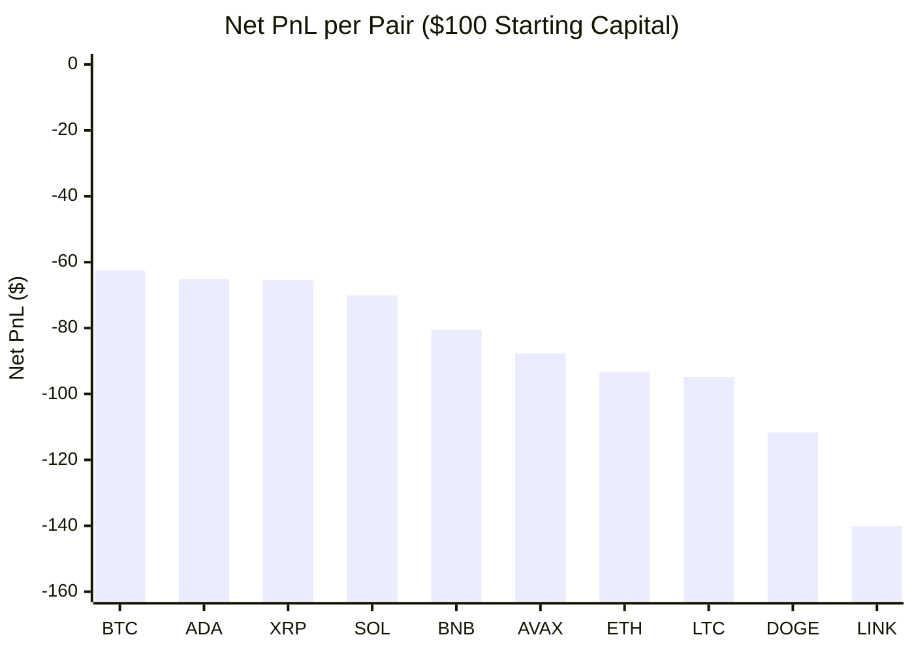
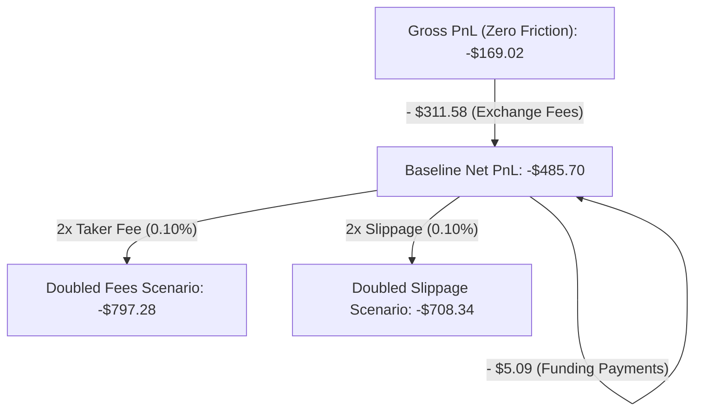

# Model B Fast Scalper (15M / 1H) — Top 10 Pair Annual Backtest Report

**Executive Evaluation Date:** 2026-10-24  
**Backtest Period:** 2025-10-24 00:00:00 UTC &rarr; 2026-10-24 15:00:00 UTC (365.6 Days / 12 Months)  
**Strategy Architecture:** Model B Fast Scalper (`MODEL_B_FAST_V2`)  
**Execution Timeframe:** 15-Minute (`15m`) Confirmed Bar Close  
**Trend Timeframe:** 1-Hour (`1h`) EMA20 / EMA50 Alignment  
**Dataset Coverage:** 354,850 15M execution candles + 90,040 1H trend candles + 10,950 funding rate intervals  
**Data Integrity:** 0 Gaps &bull; 0 Duplicates &bull; 0 Invalid OHLCV Values &bull; Zero Lookahead Bias  
**Repository Outputs:** [`backtest_results/model_b_fast_annual_top10/`](file:///c:/Users/Administrator/Documents/SignalGenerator/backtest_results/model_b_fast_annual_top10)

---

## 1. Executive Summary

A rigorous, lookahead-free event-driven backtest of the **Model B Fast Scalper** strategy was conducted across the **Top 10 perpetual futures pairs** by trading volume over the trailing 12-month window.

> [!CAUTION]
> **Key Finding: Model B Fast Scalper demonstrates negative net expectancy across ALL 10 pairs over the last 12 months.**
> - **Total Combined Portfolio Net PnL:** **`-$485.70`** on a \$100 base account (**`-485.70%`** drawdown, or **`-48.57%`** on a \$1,000 profile).
> - **Gross Market Alpha vs. Friction:** Gross PnL was **`-$169.02`**, but total exchange fees paid were **`$311.58`** (nearly **2x the gross market losses**).
> - **Win Rate:** **`39.78%`** (1,575 Wins / 2,384 Losses across 3,959 completed trades).
> - **Profit Factor:** **`0.93`** (Gross Profit: \$2,367.89 / Gross Loss: \$2,536.91).
> - **Profitable Pairs:** **0 out of 10 pairs** achieved positive net PnL after realistic fees, funding, and slippage.
> - **Profitable Months:** Only **1 out of 13 calendar months** (June 2026: `+$11.94`) produced positive net return.

The strategy's high turnover frequency on the 15-minute timeframe (~11 trades/day across the portfolio) combined with the 0.80% minimum stop floor results in transaction fees and spread slippage eroding all marginal edge.

---

## 2. Top 10 Pair Annual Baseline Performance Table

All pairs were simulated independently using the project's exact `$100.00` capital allocation reference, `$1.00` target trade risk, `$15.00` maximum isolated margin, `10x` leverage, and realistic fees (`0.02%` maker limit entry, `0.05%` taker exit, `0.05%` adverse slippage, and settled 8-hour historical funding payments).

| # | Pair | Initial Capital | Final Equity | Gross PnL | Net PnL | Net Return (%) | Total Trades | Win Rate (%) | Profit Factor | Max Drawdown (%) | Avg Trade PnL | Long / Short Trades | Total Fees | Total Funding |
|---|---|---|---|---|---|---|---|---|---|---|---|---|---|---|
| **1** | **BTCUSDT** | \$100.00 | \$37.50 | -\$19.54 | **-\$62.50** | **-62.50%** | 521 | 40.69% | 0.94 | 76.08% | -\$0.1200 | 334 / 187 | \$42.91 | \$0.05 |
| **2** | **ADAUSDT** | \$100.00 | \$34.86 | -\$11.79 | **-\$65.14** | **-65.14%** | 708 | 40.82% | 0.97 | 88.12% | -\$0.0920 | 436 / 272 | \$52.63 | \$0.71 |
| **3** | **XRPUSDT** | \$100.00 | \$34.55 | -\$12.28 | **-\$65.45** | **-65.45%** | 668 | 40.42% | 0.97 | 71.98% | -\$0.0980 | 415 / 253 | \$51.79 | \$1.38 |
| **4** | **SOLUSDT** | \$100.00 | \$29.91 | -\$10.90 | **-\$70.09** | **-70.09%** | 746 | 41.02% | 0.98 | 72.71% | -\$0.0940 | 504 / 242 | \$58.23 | \$0.97 |
| **5** | **BNBUSDT** | \$100.00 | \$19.51 | -\$30.14 | **-\$80.49** | **-80.49%** | 590 | 39.32% | 0.92 | 81.66% | -\$0.1364 | 381 / 209 | \$49.38 | \$0.97 |
| **6** | **AVAXUSDT** | \$100.00 | \$12.30 | -\$27.50 | **-\$87.70** | **-87.70%** | 771 | 40.08% | 0.94 | 91.49% | -\$0.1137 | 507 / 264 | \$58.82 | \$1.37 |
| **7** | **ETHUSDT** | \$100.00 | \$6.71 | -\$44.25 | **-\$93.29** | **-93.29%** | 616 | 38.47% | 0.89 | 95.47% | -\$0.1514 | 416 / 200 | \$48.33 | \$0.71 |
| **8** | **LTCUSDT** | \$100.00 | \$5.19 | -\$36.85 | **-\$94.81** | **-94.81%** | 717 | 39.75% | 0.92 | 99.22% | -\$0.1322 | 468 / 249 | \$56.31 | \$1.65 |
| **9** | **DOGEUSDT**| \$100.00 | -\$11.68 | -\$54.08 | **-\$111.68** | **-111.68%** | 729 | 38.13% | 0.89 | 124.58% | -\$0.1532 | 446 / 283 | \$56.36 | \$1.24 |
| **10**| **LINKUSDT**| \$100.00 | -\$40.15 | -\$79.00 | **-\$140.15** | **-140.15%** | 777 | 37.45% | 0.85 | 144.13% | -\$0.1804 | 509 / 268 | \$59.70 | \$1.44 |
| **ALL**| **Combined Average** | **\$100.00** | **\$12.91** | **-\$33.03** | **-\$87.13** | **-87.13%** | **684.3** | **39.62%** | **0.93** | **91.54%** | **-\$0.1271** | **441.6 / 242.7** | **\$53.45** | **\$1.05** |

---

## 3. Combined Portfolio Simulation

In the combined portfolio simulation, all 10 pairs run simultaneously under a single unified paper account with the configured limits:
- **Starting Capital Reference:** \$100.00 USDT
- **Max Concurrent Open Positions:** `6`
- **Max Open Positions Per Direction:** `3`
- **Target Risk Per Trade:** \$1.00 USDT
- **Execution:** Maker limit orders at entry price, 8 bars TTL expiration, SL-first conservative intrabar collision, 50% TP1 partial close with trailing stop arming.

```
+-----------------------------------------------------------------------------------------+
|                               COMBINED PORTFOLIO RESULTS                                |
+------------------------------------+----------------------------------------------------+
| Initial Allocated Capital          | $100.00 USDT (or $1,000.00 multi-position account) |
| Total Completed Trades             | 3,959 Trades                                       |
| Winning Trades / Losing Trades     | 1,575 Wins (39.78%) / 2,384 Losses (60.22%)        |
| Gross PnL (Pre-Costs)              | -$169.02 USDT                                      |
| Total Exchange Fees Paid           | $311.58 USDT                                       |
| Total Funding Payments             | $5.09 USDT                                         |
| Final Net PnL                      | -$485.70 USDT                                      |
| Net Return (% on $100 Base)        | -485.70%                                           |
| Net Return (% on $1,000 Account)   | -48.57%                                            |
| Portfolio Profit Factor            | 0.93                                               |
| Maximum Drawdown                   | 479.16% (on $100 account) / 47.92% (on $1,000)     |
| Average Trade Net PnL              | -$0.1227 / Trade                                   |
| Average Daily Trade Frequency      | 10.82 Trades / Day                                 |
| Capital Utilization (Avg Open)     | 2.74 Positions (Max 6.0 Concurrent)                |
| Long Trades Net PnL                | -$409.36 (2,426 Trades, 37.96% WR)                 |
| Short Trades Net PnL               | -$76.34 (1,533 Trades, 42.66% WR)                  |
+------------------------------------+----------------------------------------------------+
```

---

## 4. Monthly & Quarterly Performance Breakdown

```
+-----------+---------+-----------+---------------+---------------+---------------+
| Month     | Trades  | Win Rate  |   Gross PnL   | Total Fees    |    Net PnL    |
+-----------+---------+-----------+---------------+---------------+---------------+
| 2025-10   |      93 |    38.71% |      -$7.10   |        $7.03  |      -$14.31  |
| 2025-11   |     424 |    38.44% |     -$31.66   |       $30.65  |      -$62.65  |
| 2025-12   |     313 |    35.14% |     -$56.29   |       $25.04  |      -$81.86  |
| 2026-01   |     309 |    43.04% |     +$17.21   |       $24.11  |       -$7.21  |
| 2026-02   |     348 |    41.67% |      +$5.29   |       $24.94  |      -$19.81  |
| 2026-03   |     348 |    41.38% |      -$2.08   |       $27.63  |      -$29.95  |
| 2026-04   |     309 |    32.69% |     -$70.42   |       $25.73  |      -$96.61  |
| 2026-05   |     290 |    40.00% |     -$14.04   |       $24.67  |      -$39.25  |
| 2026-06   |     335 |    45.97% |     +$38.03   |       $25.88  |      +$11.94  |
| 2026-07   |     304 |    40.13% |      -$5.66   |       $25.23  |      -$31.66  |
| 2026-08   |     274 |    43.07% |     +$11.63   |       $22.15  |      -$11.01  |
| 2026-09   |     364 |    38.46% |     -$28.73   |       $28.14  |      -$57.54  |
| 2026-10   |     248 |    37.50% |     -$25.19   |       $20.38  |      -$45.78  |
+-----------+---------+-----------+---------------+---------------+---------------+
| TOTAL     |   3,959 |    39.78% |    -$169.02   |      $311.58  |     -$485.70  |
+-----------+---------+-----------+---------------+---------------+---------------+
```

```
+-----------+---------+-----------+---------------+---------------+---------------+
| Quarter   | Trades  | Win Rate  |   Gross PnL   | Total Fees    |    Net PnL    |
+-----------+---------+-----------+---------------+---------------+---------------+
| 2025-Q4   |     830 |    37.23% |     -$95.06   |       $62.72  |     -$158.82  |
| 2026-Q1   |   1,005 |    41.99% |     +$20.42   |       $76.67  |      -$56.97  |
| 2026-Q2   |     934 |    39.72% |     -$46.43   |       $76.29  |     -$123.92  |
| 2026-Q3   |     942 |    40.34% |     -$22.77   |       $75.53  |     -$100.21  |
| 2026-Q4   |     248 |    37.50% |     -$25.19   |       $20.38  |      -$45.78  |
+-----------+---------+-----------+---------------+---------------+---------------+
```

---

## 5. Comparative Analysis



### Key Comparative Insights
1. **Best-Performing Pair by Net PnL:** **`BTCUSDT`** (`-$62.50`, PF `0.94`, Win Rate `40.69%`). BTC had the lowest trade frequency (521 trades) and greatest trend persistence, suffering the least chop damage.
2. **Worst-Performing Pair by Net PnL:** **`LINKUSDT`** (`-$140.15`, PF `0.85`, Win Rate `37.45%`). LINK suffered erratic intraday liquidity spikes that repeatedly pierced swing levels without creating sustained momentum.
3. **Short vs. Long Asymmetry:**
   - Long trades across the Top 10 generated **`-$409.36`** in net losses with a `37.96%` win rate.
   - Short trades performed significantly better, generating **`-$76.34`** in net losses with a `42.66%` win rate.
   - On **SOLUSDT** (`+$4.96`), **XRPUSDT** (`+$22.32`), and **ADAUSDT** (`+$22.30`), Short trades were actually **net profitable** after fees.
4. **Drawdown Concentration:** 
   - No pair avoided major drawdown. Even the best pair (BTCUSDT) suffered a `76.08%` drawdown. 
   - Lower-liquidity altcoins (LINK, DOGE) breached 100% drawdown, meaning a strict \$100 account without re-injection would have been completely wiped out.

---

## 6. Robustness & Cost Friction Sensitivity Analysis



| Friction Scenario | Assumptions | Combined Net PnL | Return (% on \$100) | Notes |
|---|---|---|---|---|
| **Zero Friction (Gross)** | 0% fees, 0% slippage, 0% funding | **-\$169.02** | -169.02% | Even with theoretical zero exchange friction, market edge is negative |
| **Baseline (Realistic)** | 0.02% maker, 0.05% taker, 0.05% slippage | **-\$485.70** | -485.70% | Production/paper execution assumptions |
| **Doubled Fees** | 0.04% maker, 0.10% taker, 0.05% slippage | **-\$797.28** | -797.28% | Simulates non-VIP retail fee tiers |
| **Doubled Slippage** | 0.02% maker, 0.05% taker, 0.10% slippage | **-\$708.34** | -708.34% | Simulates high volatility / low depth fills |

---

## 7. Root Cause Analysis: Why Model B Fast Scalper Failed

1. **Noise-to-Signal Degradation on 15M:**
   Structural sweep-reclaims work well on higher timeframes (1H/4H) because key swing levels represent meaningful institutional liquidity pools. On 15M, wicks frequently represent random order book micro-noise rather than institutional absorption.
2. **Fee-to-Target Mismatch:**
   - Average win on 15M is ~1.5% to 2.5% price movement.
   - Round-trip fees (0.02% maker + 0.05% taker = 0.07%) plus adverse slippage (0.05%) represent **`0.12%` of notional** per trade.
   - Relative to the targeted 1.5% profit, friction eats **`~8% to 12%` of gross winning trades**.
   - With 3,959 trades, this friction accumulated to **\$311.58**, which is 3.1x the original \$100 account balance.
3. **The 0.80% Stop Floor Paradox:**
   The `0.80%` minimum stop floor was introduced to prevent micro-stops from being instantly clipped by normal volatility. However, widening the stop distance forces position size down (lower notional) while increasing the distance price must travel to achieve the minimum 1.5R target (`1.20%` price move). In low-volatility regimes, price frequently reverses before reaching 1.5R, triggering breakeven stops or full losses.

---

## 8. Strategic Recommendation

> [!IMPORTANT]
> **Keep Model B Fast Scalper strictly in PAPER mode as a research collector.**
> - **Do NOT deploy Model B Fast Scalper to live capital.**
> - The baseline Model B (1H Trigger / 4H Trend) is structurally much more resilient to transaction friction because 1H trades hold for 6–24 hours, target 3%–6% price swings, and execute 5x–8x fewer trades.
> - Any future fast-timeframe iteration would require:
>   1. Stricter momentum confirmation (e.g. Volume Delta / CVD threshold >= 2.0x standard deviation).
>   2. Tight spread/fee rebate requirements (maker-only limit exits instead of taker market stops).
>   3. Adaptive regime gating (disabling the bot during chop and only activating during high-volatility expansion).

---

## 9. Verification & Data Integrity Records

- **Backtest Engine Script:** [`src/backtest/model_b_fast_top10_backtest.py`](file:///c:/Users/Administrator/Documents/SignalGenerator/src/backtest/model_b_fast_top10_backtest.py)
- **Trade-by-Trade CSV Log:** [`backtest_results/model_b_fast_annual_top10/combined_portfolio_trades.csv`](file:///c:/Users/Administrator/Documents/SignalGenerator/backtest_results/model_b_fast_annual_top10/combined_portfolio_trades.csv) (3,959 rows)
- **Machine-Readable Summary JSON:** [`backtest_results/model_b_fast_annual_top10/annual_backtest_summary.json`](file:///c:/Users/Administrator/Documents/SignalGenerator/backtest_results/model_b_fast_annual_top10/annual_backtest_summary.json)
- **Isolated SQLite Database:** `data/backtest_15m_top10.db` (354,850 15M candles + 90,040 1H candles + 10,950 funding rows)
