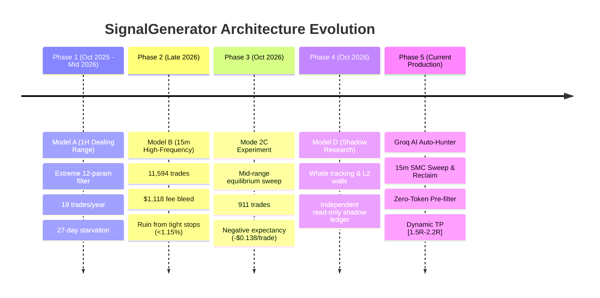

# SignalGenerator — Project Evolution & Architectural History

**Archive Document:** `data_penting/PROJECT_HISTORY.md`  
**Author:** Quantitative Trading & System Architecture  
**Date:** 2026-10-27  

---

## 1. Executive Timeline & Strategic Milestones

The SignalGenerator project evolved through five distinct architectural phases, transitioning from overly rigid hand-crafted rule models to high-frequency fee traps, experimental mid-range sweeps, and ultimately to the verified hybrid production system: **Groq AI Auto-Hunter (`15M_SWEEP_RECLAIM_SMC`)**.

---

## 2. Phase 1: Model A — Hand-Crafted 1H Dealing Range & Signal Starvation

### Initial Concept:
Model A (`src/strategy/generator.py`, `src/strategy/planner.py`) attempted to identify higher-timeframe swing trades on 1H and 4H candles by segmenting the 72-hour price range into Extreme Discount ($\le 12\%$) and Extreme Premium ($\ge 88\%$), or Bull Expansion breakouts ($\ge 92\%$).

### Empirical Outcome:
- **`MODEL_A_FROZEN`:** Over an entire 365-day backtest (`2025-10-24` to `2026-10-24`), only **19 trades** were executed across 11 whitelisted symbols (~1.6 trades per month for the *entire* universe).
- **27-Day Signal Drought:** Between `2026-09-20` and `2026-10-17`, the scanner produced **0 forward paper candidates** for 27 consecutive days.
- **The Stop-Loss Clamping Defect:** `TPSLPlanner` forced stop-losses to clamp to an artificial `2.2%` / `2.4%` distance so a $60 notional order wouldn't exceed the $1.50 risk ceiling. This placed stop-losses *inside* the Order Block or Swing Low, causing market noise to sweep the stop-loss prematurely before reaching Take-Profit.

---

## 3. Phase 2: Model B — High-Frequency 15m Scalping & Fee Ruin

### Initial Concept:
To eliminate signal starvation, Model B (`src/strategy/model_b/`, `src/backtest/model_b_*.py`) moved execution to 15m candles with rapid breakout entries, tighter stop distances, and dual-bot grid sweeps.

### Empirical Outcome:
- **Catastrophic Over-Trading (`MODEL_B_V1`):** Produced **11,594 trades** in 12 months.
- **Fee Friction Catastrophe:** Generated **-$1,577.17 Net PnL**, of which **$1,118.41 was consumed entirely by exchange maker/taker fees and slippage**!
- **Max Drawdown:** -$1,597.98 (a 1466% drawdown relative to the $16 capital base).
- **Core Insight:** Scalping crypto perpetuals on 15m with stop distances $<1.15\%$ is mathematically negative-sum due to the round-trip fee floor ($0.07\%-0.10\%$) consuming $>30\%-50\%$ of the gross statistical edge.

---

## 4. Phase 3: Mode 2C — The Mid-Range Equilibrium Sweep Fallacy

### Research Hypothesis:
Documented in `docs/mode2c_strategy_spec.md`, the quantitative team hypothesized that liquidity sweeps inside the middle 60% of the 72H dealing range ($0.20 \le \text{pos}_{72} \le 0.80$) could provide frequent, profitable internal range rotations.

### Empirical Outcome:
- Documented in `docs/mode2c_backtest_report.md`: Mode 2C generated **911 setups** but delivered a definitive negative net expectancy of **-$0.1382 USDT/trade** (Win Rate: `35.49%`, Net PnL: **-$102.41 USDT**, Max DD: **$118.36 USDT**).
- **Why Mid-Range Sweeps Fail:** In range equilibrium, price lacks directional momentum and is subject to high-frequency chop. Wick reclaims in mid-range frequently form multi-wick liquidity cascades where each subsequent bar pierces the previous low/high before continuing trend rotation, repeatedly triggering stop losses before opposing boundaries are reached.
- **Decision:** Permanently rejected and blocked.

---

## 5. Phase 4: Model D — Shadow Order Flow & Whale Tracking

### Purpose:
Model D (`src/model_d/`, `docs/model_d_operations.md`) was implemented as a strictly independent, read-only research surface for orderbook liquidity features, resting whale walls, and cross-venue depth benchmarking.
- It operates strictly in memory with an isolated shadow ledger.
- It contains zero execution capabilities and cannot submit exchange orders.
- It pioneered the L2 orderbook wall detection later unified into the live trading engine's take-profit targeting.

---

## 6. Phase 5: The Production Solution — Groq AI Auto-Hunter (`15M_SWEEP_RECLAIM_SMC`)

### Breakthrough Innovations:
1. **Unification of SMC & Dealing Range Locks:** Trade entries are strictly locked to Dealing Range Discount ($\le 38\%$) for Longs and Premium ($\ge 65\%$) for Shorts. Equilibrium ($38\%-65\%$) is an unbypassable hard directional veto.
2. **Zero-Token Python Pre-Filter:** To prevent exhausting Groq free-tier rate limits (TPM/TPD), 100% of candidate evaluation occurs in local Python before calling Groq. If 0 candidates pass the SMC and Dealing Range gates, zero Groq tokens are consumed.
3. **2-Pass Groq LLM Ranking Funnel:** When qualified candidates exist, Groq LLM (`qwen/qwen3.8-27b`) narrows Top 10 to Top 3 finalists, then deeply inspects the #1 setup with qualitative market reasoning.
4. **Dynamic Structural Take-Profit (`compute_dynamic_structural_tp`):** Replaces rigid fixed 2.0R targets with dynamic targets front-running 15m/1H swing highs and L2 orderbook ask walls in the [1.50R, 2.20R] sweet spot.
5. **Adaptive TP Refresh & Invalidation Monitoring:** Background worker continuously monitors open positions, atomically replacing TP orders as resistance evolves without churning, and ratcheting stop-loss to breakeven at 1.0R profit.
6. **Institutional Risk Controls:** Governed by `GlobalPositionLock` (max 1 concurrent position), $0.20 fixed dollar risk, $0.45 daily loss cap, and 3 entries/day ceiling.
