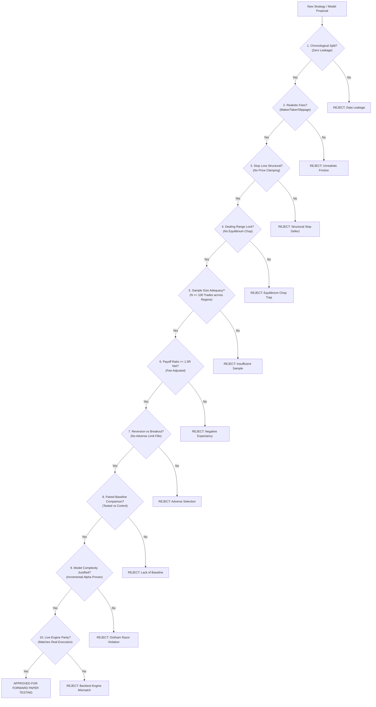

# SignalGenerator — Repeated Failure Prevention & Pre-Experiment Verification Gates

**Archive Document:** `data_penting/REPEATED_FAILURE_PREVENTION.md`  
**Purpose:** Mandatory pre-experiment verification checklist and governance gates  
**Scope:** Required for all future quantitative research, strategy revisions, and model training  

---

## 1. Mandatory Research Governance Rule

> **RULE OF RESEARCH INTEGRITY:**  
> Before any quantitative backtest, machine learning model training job, or strategy modification is deployed or merged into the codebase, the researcher must complete the following 10-point Pre-Experiment Verification Checklist. The hypothesis must explicitly document which historical failure modes from `data_penting/` it resolves.

---

## 2. The 10-Point Pre-Experiment Verification Checklist

---

### Gate 1: Chronological Time Split & Zero Data Leakage
- **Requirement:** Dataset must be partitioned strictly by chronological time: `TRAIN` $\rightarrow$ `VAL` $\rightarrow$ `OOS_TEST`. Never use random K-fold cross-validation or shuffles on time series.
- **Historical Evidence:** `docs/profitability_failure_attribution.md` showed Model A achieved 75% win rate in `TRAIN` but 0% in `OOS_TEST` because volatile cluster features leaked into earlier training slices.

### Gate 2: Realistic Exchange Fees, Funding & Slippage Friction
- **Requirement:** Every backtest must apply at minimum: $0.02\%$ maker entry, $0.05\%$ taker stop loss, $0.05\%$ adverse slippage, and realized 8-hour funding settlements.
- **Historical Evidence:** `MODEL_B_V1` generated -$1,577 Net Loss with $1,118.41 consumed by fees alone (`backtest_results/model_a_vs_model_b_comparison/REPORT.md`). A gross edge is meaningless without net fee profitability.

### Gate 3: Structural Stop Loss Placement (Zero Price-Clamping)
- **Requirement:** The stop-loss price must be placed strictly beyond market structural invalidation (Swing High/Low or Order Block + buffer). Never clamp or pull the stop price closer to entry to fit a risk limit. If risk is exceeded, size (quantity) must shrink.
- **Historical Evidence:** `src/strategy/planner.py:72-97` clamped stops to 2.2% to satisfy a $1.50 risk ceiling, resulting in routine premature stop-outs during intrabar noise (`docs/profitability_failure_attribution.md`).

### Gate 4: Dealing Range Zone Locks (Zero Equilibrium Entries)
- **Requirement:** For Longs, entry must strictly be in Dealing Range Discount ($\le 38\%$). For Shorts, entry must strictly be in Dealing Range Premium ($\ge 65\%$). The equilibrium zone ($38\%-65\%$) must remain a hard directional veto.
- **Historical Evidence:** `MODE_2C` attempted mid-range sweeps inside equilibrium and lost -$102.41 USDT across 911 trades (`docs/mode2c_backtest_report.md`).

### Gate 5: Sample Size & Temporal Distribution
- **Requirement:** A strategy must generate $\ge 100$ trades distributed across at least 3 distinct market regimes (bull expansion, bear contraction, multi-week consolidation). Setups clustered in $<5$ calendar days must be disqualified.
- **Historical Evidence:** Model A generated 50 of its 92 lifetime trades in just 3 calendar days (`2026-08-20..22`), followed by 27 days of zero signals (`docs/profitability_phase0_audit.md`).

### Gate 6: Fee-Adjusted Payoff Ratio ($\ge 1.50\text{R}$ Net)
- **Requirement:** Expected reward-to-risk must be at least $1.50\text{R}$ Net after deducting round-trip fees.
- **Historical Evidence:** Model B scalp targets ($0.8\%-1.2\%$) resulted in an average payoff ratio of $0.81-0.87$, guaranteeing long-term mathematical ruin.

### Gate 7: Sweep & Reclaim Over Breakout Chasing
- **Requirement:** Strategy must enter on confirmed liquidity sweep and body reclaim (buying the failed breakdown), avoiding resting limit orders placed below momentum breakouts.
- **Historical Evidence:** Model A limit breakout orders suffered adverse selection: true breakouts expired unfilled, while false breakouts filled and immediately stopped out.

### Gate 8: Paired Baseline Control Comparison
- **Requirement:** Any experimental feature (e.g. LLM scoring, volume filter, new indicator) must be tested against a control baseline on identical data slices using paired difference testing.
- **Historical Evidence:** Mode 2C was tested directly against Baseline Control in `docs/mode2c_backtest_report.md`, which cleanly proved it degraded baseline net PnL from +$16.80 to -$15.96.

### Gate 9: Ockham's Razor — Model Complexity vs. Incremental Alpha
- **Requirement:** A complex model (e.g. deep learning, multi-agent LLM) must demonstrate statistically significant higher Net Expectancy over simple deterministic rules.
- **Historical Evidence:** A logistic regression model trained on <50 samples (`src/ml/calibration.py`) had a 98.9% pass rate and added zero statistical edge while introducing deserialization bugs.

### Gate 10: Production Execution Engine Parity
- **Requirement:** The simulation must use the identical timeframe, tick normalization, and order lifecycle as the production execution engine (`AsterDexV3Adapter`).
- **Historical Evidence:** `BACKTEST_ENGINE_VALIDATION.md` revealed that `BacktestEngine` tested Model A 1H logic and was completely incapable of evaluating the live `15M_SWEEP_RECLAIM_SMC` strategy.

---

## 3. Mandatory Sign-Off Protocol

Before submitting code to `main` or authorizing `LIVE_AUTO`:
1. All 10 gates above must be marked `PASSED`.
2. Dedicated regression test suite must pass 100% (currently 1,111 tests in `tests/`).
3. Production daemon must verify that `GlobalPositionLock`, $0.20 fixed risk, $0.45 daily loss limit, and 3 entries/day ceiling remain unbypassed.
