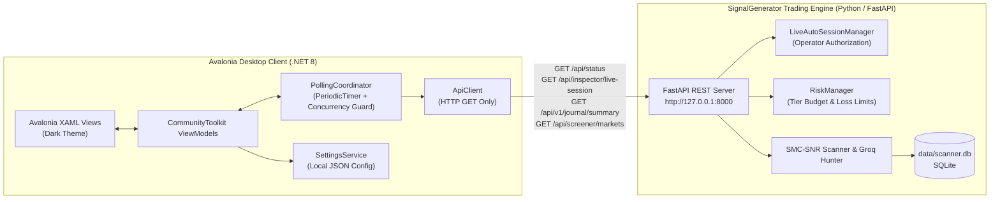

# SignalGenerator Desktop Terminal (.NET 8 + Avalonia UI)

Lightweight, high-performance Windows desktop trading terminal for **SignalGenerator**, engineered with **C# + .NET 8 LTS + Avalonia UI + MVVM + CommunityToolkit + Skia-based rendering**.

---

## 1. System Architecture & Safety Invariants



### Core Safety Invariants

1. **Non-Invasive Client**: The desktop application operates strictly as a consumer of the FastAPI backend. It does not replace, reconfigure, or modify the Python trading runtime.
2. **Zero Direct SQLite Access**: The C# desktop application has **no direct database connection** to `data/scanner.db`. All state is queried exclusively through the FastAPI HTTP REST API.
3. **Read-Only API Communication**: All HTTP requests issued by `ApiClient` are strictly **HTTP GET** queries. Mutating endpoints (starting/stopping live auto trading, changing modes, creating or cancelling exchange orders) are omitted from the client to prevent accidental order execution or session invalidation.
4. **Git Branch Isolation**: All desktop code is maintained exclusively on the isolated `feature/avalonia-desktop` branch. It is never committed directly or merged to `main`.
5. **Daemon Preservation**: The active backend process (Uvicorn daemon on port 8000) and exchange invariants (open positions, limit orders) remain completely untouched.

---

## 2. Project Structure

```
desktop/
├── README.md                                # Comprehensive desktop documentation
├── SignalGenerator.Desktop.slnx             # .NET solution linking Desktop and Tests
├── src/
│   └── SignalGenerator.Desktop/             # Main desktop application project
│       ├── SignalGenerator.Desktop.csproj   # net8.0, Avalonia 12.1.4, MVVM 8.4.2, ScottPlot 5.1.59
│       ├── Program.cs                       # Avalonia application entry point
│       ├── App.axaml / App.axaml.cs         # Dark theme setup & DI service registration
│       ├── ViewLocator.cs                   # MVVM view locator template
│       ├── app.manifest                     # Windows dpi awareness & compatibility
│       ├── Models/                          # Strongly typed JSON DTOs & envelopes
│       │   ├── ApiResult.cs                 # Generic result envelope with status codes
│       │   ├── DesktopSettings.cs           # Client configuration (URL, polling interval)
│       │   ├── SystemStatusDto.cs           # Maps /api/status (Account, Risk, Scanner)
│       │   ├── LiveSessionDto.cs            # Maps /api/inspector/live-session
│       │   ├── JournalSummaryDto.cs         # Maps /api/v1/journal/summary
│       │   └── MarketTickerDto.cs           # Maps /api/screener/markets
│       ├── Services/                        # Business logic & network services
│       │   ├── IApiClient.cs / ApiClient.cs # Typed, read-only HTTP GET client
│       │   ├── ISettingsService.cs / ...    # Local settings persistence
│       │   └── IPollingCoordinator.cs / ... # Concurrency-guarded background polling
│       ├── ViewModels/                      # MVVM Observable ViewModels
│       │   ├── ViewModelBase.cs             # CommunityToolkit ObservableObject base
│       │   ├── MainViewModel.cs             # Shell navigation & top telemetry bar
│       │   ├── OverviewViewModel.cs         # Real-time session, risk & scanner telemetry
│       │   ├── ScreenerViewModel.cs         # Multi-market perpetuals with pagination
│       │   ├── JournalViewModel.cs          # Performance metrics & closed trade analytics
│       │   ├── LiquidityIntelViewModel.cs   # Orderbook wall clusters & whale activity
│       │   ├── AlertsViewModel.cs           # Signal notification logs
│       │   ├── GroqHunterViewModel.cs       # 4-stage Groq AI pipeline diagnostics
│       │   └── SettingsViewModel.cs         # Base URL and polling configuration
│       └── Views/                           # Dark-themed Avalonia XAML Views
│           ├── MainWindow.axaml             # Terminal shell with sidebar & status bar
│           ├── OverviewView.axaml           # Metric cards, risk gates, capacity display
│           ├── ScreenerView.axaml           # Multi-exchange market asset table
│           ├── JournalView.axaml            # Trade statistics & reconciliation summary
│           ├── LiquidityIntelView.axaml     # L2 depth & whale wall clusters
│           ├── AlertsView.axaml             # Dispatch logs
│           ├── GroqHunterView.axaml         # AI Auto-Hunter 4-stage pipeline telemetry
│           └── SettingsView.axaml           # Backend connectivity & polling controls
└── tests/
    └── SignalGenerator.Desktop.Tests/       # Unit test suite
        ├── SignalGenerator.Desktop.Tests.csproj
        ├── DtoSerializationTests.cs         # JSON parsing tests with verified live fixtures
        ├── ApiClientTests.cs                # HTTP mock tests for GET endpoints and errors
        ├── PollingCoordinatorTests.cs       # Periodic polling, error and cancellation tests
        ├── SettingsServiceTests.cs          # Configuration load/save tests
        └── OverviewViewModelTests.cs        # Telemetry binding tests
```

---

## 3. Integrated Endpoints (Read-Only)

| Endpoint | HTTP Method | Frequency | Model / DTO | Purpose |
|---|---|---|---|---|
| `/api/status` | `GET` | 3s (Polled) | `SystemStatusDto` | System mode, session state, account equity, risk gates, scanner state |
| `/api/inspector/live-session` | `GET` | 3s (Polled) | `LiveSessionEnvelopeDto` | Preflight verdict (`GO`), entries placed (`1 / 3`), position lock state |
| `/api/v1/journal/summary` | `GET` | 3s (Polled) | `JournalSummaryDto` | Win rate, profit factor, average R, net PnL, remaining entry allowance |
| `/api/screener/markets` | `GET` | On-Demand | `ScreenerResponseDto` | Multi-exchange market prices, 24h volume, open interest, best spreads |
| `/api/chart/symbols` | `GET` | On-Demand | `List<string>` | Supported tradeable asset universe |

---

## 4. Build & Execution

### Prerequisites

- Windows 10/11
- .NET 8.0 SDK or .NET 10 SDK (target runtime: `net8.0`)
- SignalGenerator FastAPI backend running on `http://127.0.0.1:8000`

### Build the Solution

```powershell
dotnet build desktop/SignalGenerator.Desktop.slnx
```

### Run Unit Tests

```powershell
dotnet test desktop/SignalGenerator.Desktop.slnx
```

### Launch the Desktop Application

```powershell
dotnet run --project desktop/src/SignalGenerator.Desktop/SignalGenerator.Desktop.csproj
```

---

## 5. View Specifications

1. **Top Telemetry Header**:
   - Connection Status Badge: Green `CONNECTED` indicator with live ping.
   - Mode & Session State: High-contrast badges for `LIVE_AUTO` and `ACTIVE`.
   - Global Position Lock: Displays `LOCKED: BZUSDT` or `UNLOCKED`.
   - Account Equity: Real-time verified equity from AsterDEX (e.g. `$14.4652 USDT`).
   - Manual Poll Button (`↻ Poll`) and last refresh timestamp.

2. **Overview**:
   - Live Session Card: Mode, state, session ID, preflight verdict.
   - Capacity Card: Entries Placed vs Limit (e.g. `1 / 3`), global lock state.
   - Account Equity Card: Total equity, available balance, used margin.
   - Scanner Card: Scan count, process status, active strategy (`15M_SWEEP_RECLAIM_SMC`).
   - Risk Gates Panel: Daily loss usage vs limit (`$0.00 / $0.45 USDT`), effective trade risk (`$0.15 USDT`), can open position verdict.
   - Live Audit Banner: Latest operational messages from session manager.

3. **Market Screener**:
   - Paginated table of cross-venue perpetual assets.
   - Ticker search box with instant filtering.
   - Displays 24h volume turnover, open interest, benchmark price, 24h change %, venue count, and bid-ask spread.

4. **Trade Journal**:
   - Win rate %, profit factor, average realized R, net PnL, gross PnL, total fees paid.
   - Daily entry allowance utilization and reconciliation health.

5. **Liquidity Intel**:
   - L2 cross-book depth, major bid/ask walls, whale accumulation clusters.

6. **Groq AI Auto-Hunter**:
   - Inference model telemetry (`llama-3.3-70b-versatile`), API key vault status, 4-stage pipeline diagnostics.

7. **Settings**:
   - Configurable backend URL (default `http://127.0.0.1:8000`).
   - Polling interval adjustment (1 to 60 seconds).
   - Auto-polling toggle.
