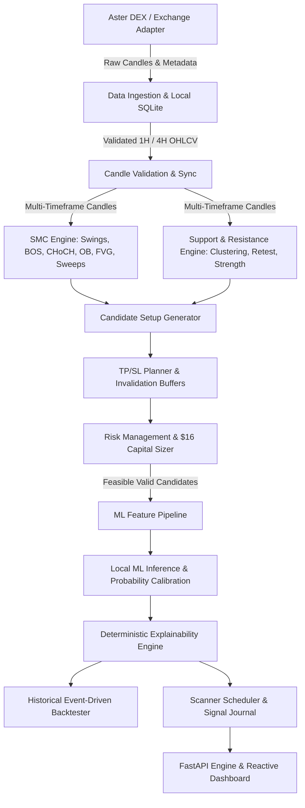

# SMC-SNR ML Perpetual Setup Scanner: Architecture & Technical Specification

## 1. System Mission & Philosophy
The **SMC-SNR ML Perpetual Setup Scanner** is an institutional-grade, zero-generative-AI quantitative trading system engineered specifically for cryptocurrency perpetual futures. It is designed to operate on small initial capital ($16 USDT) with rigorous risk governance, multi-timeframe deterministic market structure detection (Smart Money Concepts + Support & Resistance), and local, leakage-free machine learning probability calibration.

### Core Invariants:
1. **Zero LLM / External Generative AI**: All pattern detection, bias calculation, risk allocation, ML inference, and setup explanations are generated by auditable, deterministic Python logic and local ML models (scikit-learn, LightGBM/XGBoost).
2. **Leakage & Lookahead Prevention**:
   - Swings require structural closure confirmation before detection.
   - All ML features are extracted strictly from closed candles prior to or at the candidate timestamp.
   - Chronological walk-forward splits only (60% Train, 20% Validation, 20% Out-Of-Sample Test).
   - Target labeling evaluates conservative first-touch rules (conservative SL-first if both TP and SL hit within the same candle).
3. **Strict Risk & Sizing Controls for $16 Capital**:
   - Default Initial Capital: $16.00 USDT.
   - Margin Mode: `ISOLATED` exclusively.
   - Leverage: Maximum 10x (configurable, hard ceiling).
   - Trade Risk Budget: ~$0.09 per trade (default).
   - Daily Loss Limit: ~$0.18 (2 trade losses shut down the day).
   - Weekly Loss Limit: ~$0.54 (6 trade losses shut down the week).
   - Account Position Limit: Maximum 1 concurrent open position across the entire account.
   - Entry Frequency Ceiling: Maximum 3 entries per calendar week.
   - Infeasible Rejections: If position sizing cannot satisfy exchange minimum notional ($5.00 on Aster DEX) or lot step size without exceeding the trade risk budget, the setup is strictly rejected as `INFEASIBLE`.
   - Positive Expectancy Filter: Candidate setups must show positive net expectancy after maker/taker fees, slippage, and funding.
4. **Safety & Execution Modes**:
   - `RESEARCH`: Historical data ingestion, feature generation, ML training, walk-forward backtesting.
   - `PAPER`: Real-time / scheduled candle polling, setup scanning, journal logging, simulated execution without exchange order submission.
   - `LIVE`: Permanently disabled and locked during this phase. No exchange API private keys required or exposed.

---

## 2. Target Exchange: Aster DEX Perpetual Futures
- **Exchange Base URL**: `https://fapi.asterdex.com`
- **API Architecture**: Standard Binance Futures v1 compatible REST protocol (`/fapi/v1/*`).
- **Verified Endpoints**:
  - `GET /fapi/v1/ping`: Connectivity heartbeat.
  - `GET /fapi/v1/exchangeInfo`: Market metadata, contract specifications, precision rules, and filter limits.
  - `GET /fapi/v1/klines`: Historical and recent OHLCV candlestick data.
  - `GET /fapi/v1/fundingRate`: Historical funding payment rates.
- **Initial 11-Symbol Watchlist (Verified Active)**:
  `ADAUSDT`, `XRPUSDT`, `BTCUSDT`, `BNBUSDT`, `ETHUSDT`, `SOLUSDT`, `AVAXUSDT`, `LINKUSDT`, `XMRUSDT`, `DOGEUSDT`, `LTCUSDT`.
- **Trading Constraints**:
  - `contractType`: `PERPETUAL`
  - `marginAsset`: `USDT`
  - `MIN_NOTIONAL`: $5.00
  - `LOT_SIZE`: Specific per symbol (e.g. BTC 0.001, ADA 1.0, DOGE 1.0).

---

## 3. High-Level Modular Architecture

---

## 4. Subsystem Breakdown

### 4.1 Data Layer (`src/data`)
- **SQLite Database**: Stores raw downloaded candles, symbol metadata, candidate setups, and signal journal entries.
- **Resumable Downloader**: Backfills 365 days of 1H and 4H candles in batches of 1000 candles. Handles rate limiting, pagination, and network retries with exponential backoff.
- **Validator**: Checks candle timestamps, detects missing intervals, prevents duplicate candles, checks OHLC consistency (`low <= open, close <= high`), and rejects incomplete open candles.

### 4.2 SMC Feature Engine (`src/smc`)
- **Swing Detection**: Non-lookahead $N$-bar pivot detection. A swing at index $t$ is confirmed only at index $t + \text{confirmation\_bars}$.
- **Market Structure**:
  - Bullish: Higher Highs (HH) and Higher Lows (HL).
  - Bearish: Lower Highs (LH) and Lower Lows (LL).
  - BOS (Break of Structure): Candle close breaking previous swing in trend direction.
  - CHoCH (Change of Character): Candle close breaking previous swing opposite to prevailing trend.
- **Liquidity Sweeps**: Candle wick extending beyond recent swing high/low followed by a close back inside the range.
- **Order Blocks (OB)**: The last opposing candle before an energetic displacement breaking structure. Defined by upper and lower boundary, mitigated status, and volume.
- **Fair Value Gaps (FVG)**: 3-candle imbalance where Candle 1 High < Candle 3 Low (Bullish) or Candle 1 Low > Candle 3 High (Bearish).

### 4.3 Support & Resistance Engine (`src/snr`)
- **Swing Cluster Zones**: Dynamic density-based clustering of historical swing levels within ATR-based tolerance.
- **Zone Interaction**:
  - Touch: Candle low/high enters zone without closing through.
  - Breakout: Decisive candle close past zone.
  - Retest: Subsequent pullback touching broken zone that now acts as flipped support/resistance.
  - Rejection: Long wick rejecting the zone.
- **Zone Invalidation & Strength**: Calculated chronologically without future knowledge based on test counts, touch freshness, and volume profile.

### 4.4 Strategy & TP/SL Planner (`src/strategy`)
- **4H Bias Alignment**: Directional filter matching 4H market structure and EMA trend.
- **1H Setup Execution**:
  - Pullback to 1H/4H Order Block or FVG.
  - Retest of clustered S/R level following liquidity sweep or CHoCH.
- **Structural SL**: Placed beyond the invalidation swing/OB boundary plus ATR volatility buffer.
- **Structural TP**: Placed at the opposing liquidity target or major structural S/R zone.
- **Cost Deductions**: Estimated fees (maker 0.02% / taker 0.05%), slippage (0.05%), and 8-hour funding buffer deducted to produce net R:R.

### 4.5 Risk & Sizing Engine (`src/risk`)
- **Risk Budget**:
  $$\text{effective\_risk} = \min(\text{trade\_risk}, \text{remaining\_daily\_loss}, \text{remaining\_weekly\_loss})$$
- **Position Sizing**:
  $$\text{position\_notional} = \frac{\text{effective\_risk}}{\text{stop\_distance\_fraction}}$$
  $$\text{required\_margin} = \frac{\text{position\_notional}}{\text{leverage}}$$
- **Validation Gates**:
  1. $\text{position\_notional} \ge \text{exchange\_min\_notional}$ ($5.00).
  2. $\text{required\_margin} + \text{estimated\_fees} \le \text{available\_capital}$ ($16.00).
  3. $\text{actual\_risk} \le \text{configured\_risk\_budget}$ ($0.09).
  4. Max open positions = 1.
  5. Weekly entries $\le 3$.
  6. Net Expectancy $> 0$.

### 4.6 Machine Learning Engine (`src/ml`)
- **Zero Generative AI**: LightGBM Classifier, Logistic Regression baseline, CalibratedClassifierCV / Isotonic Regression.
- **Leakage-Safe Features**: 30+ engineered metrics available at signal timestamp (ATR, relative volume, body/wick ratios, S/R distance, R:R, 4H bias strength, sweep depth, regime).
- **Target Definition**: Binary indicator of whether TP is reached before SL within $H=12$ bars (conservative SL-first if simultaneous).
- **Evaluation**: Log loss, Brier score, ROC-AUC, Reliability diagrams, and Out-of-Sample Expected Value.

### 4.7 Backtest & Performance Engine (`src/backtest`)
- **Event-Driven Simulation**: Strictly tick/bar-by-bar progression across 365 days of historical data.
- **Execution Modeling**: Realistic entry on the open of the bar following confirmation, realistic spread, slippage, maker/taker commissions, and funding payments.
- **Comparative Analysis**:
  1. Deterministic SMC/SnR Baseline.
  2. ML-Filtered SMC/SnR.
  3. Simple Moving Average Crossover Benchmark.
  4. Buy-and-Hold Reference.

---

## 5. Security & Risk Philosophy
- No hardcoded secrets. No live private keys stored.
- Live trading is locked at the code and configuration level.
- Read-only public market data is used for Research and Paper modes.
