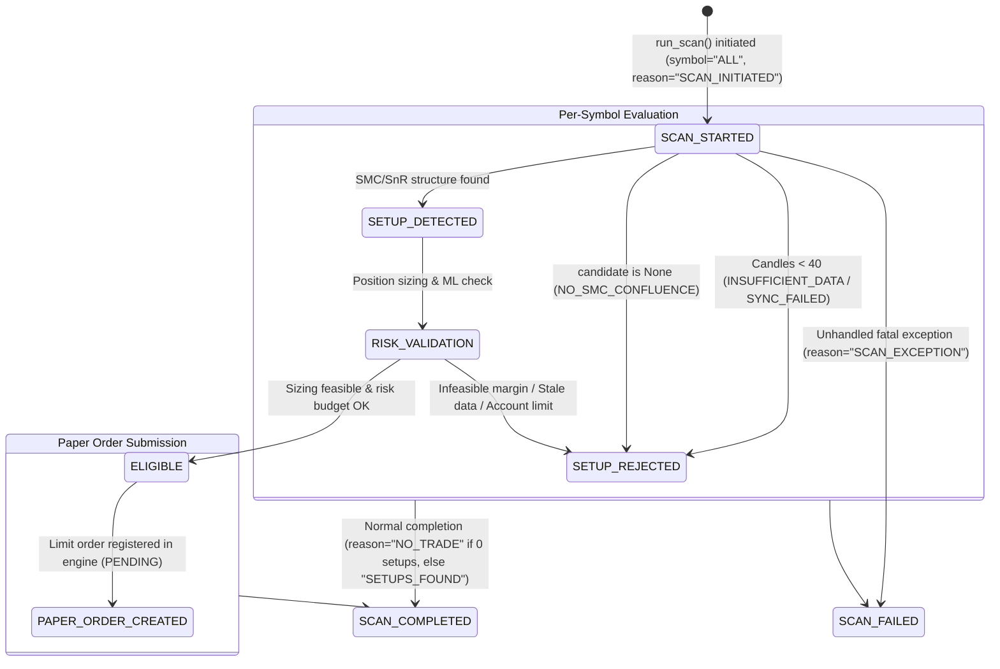

# SignalGenerator — Forward Scan Observability & Cohort Integrity Audit Report

**Audit Date:** 2026-10-17  
**Branch:** `research/profitability-validation`  
**Scope:** Task B — Scan Cycle Observability & Task C — Forward Cohort Integrity  
**System Status:** `READY_FOR_FORWARD_PAPER`  
**Profitability Status:** `UNPROVEN_NO_COMPLETED_FORWARD_TRADES` (Preserved — zero artificial promotions)

---

## 1. Executive Summary

During prior forward paper monitoring, `paper_lifecycle_events` contained 0 rows during scan cycles where no setup met the institutional SMC/SnR criteria. This absence of records produced operational ambiguity: an observer inspecting the SQLite database or dashboard could not distinguish whether the background scanner daemon was stalled, dying silently, encountering exchange disconnects, or operating properly in a market state offering `NO_TRADE`.

To eliminate this ambiguity without altering strategy filters or relaxing risk bounds:
1. `ScannerRunner.run_scan()` was instrumented with lifecycle event emissions for **every scan cycle**, including complete empty cycles (`candidate_count=0`).
2. Standardized lifecycle states were implemented: `SCAN_STARTED`, `SCAN_COMPLETED`, `SCAN_FAILED`, `SETUP_DETECTED`, `SETUP_REJECTED`, `RISK_VALIDATION`, `ELIGIBLE`, and `PAPER_ORDER_CREATED`.
3. Granular rejection reason codes distinguish between:
   - Market conditions failing structural confluence (`NO_SMC_CONFLUENCE`),
   - Insufficient historical candle depth (`INSUFFICIENT_DATA`),
   - Network / exchange candle synchronization timeouts (`SYNC_FAILED`),
   - Market data staleness exceeding threshold (`REJECTED_STALE` / `STALE_DATA`),
   - Order sizing feasibility violations (`REJECTED_INFEASIBLE`),
   - Account risk guardrail throttles (`REJECTED_WATCHLIST`),
   - Structural price invalidation (`REJECTED_INVALIDATED`),
   - Unhandled runtime scan crashes (`SCAN_FAILED` with `SCAN_EXCEPTION`).
4. Forward cohort parameters established at `2026-10-17 15:00:00 UTC` on commit `a89b15a4a24b84a4db5f7e622fefffc70c876f75` remain strictly preserved.

---

## 2. Root Cause Diagnosis of Empty Lifecycle Events

In previous revisions of `src/scheduler/runner.py` (lines 334–342):
```python
candidate = self.generator.generate_candidate(
    symbol=sym,
    candles_1h=c1_list,
    candles_4h=c4_list,
)

if candidate is None:
    continue  # <-- DEFECT: Cycle skipped silently with zero event logging!
```
When market prices traded between the 72H dealing range discount threshold (0.12) and premium threshold (0.88), or lacked clean order block / FVG confluences, `generate_candidate` returned `None`. Because the loop executed `continue`, no record was written to `paper_lifecycle_events`. Consequently, cycles where all 11 watchlist symbols returned `None` produced zero lifecycle records, creating a false appearance of scanner inactivity.

---

## 3. Scan Lifecycle Event Schema & State Machine



### 3.1 Event Taxonomy & Metadata Schema

All lifecycle transitions are recorded in `paper_lifecycle_events` with the following contract:

| Lifecycle Stage | Symbol Scope | Reason Code | When Emitted | Example Metadata |
|---|---|---|---|---|
| `SCAN_STARTED` | `ALL` | `SCAN_INITIATED` | Cycle start across watchlist. | `{"symbols": ["BTCUSDT", ...], "sync_live": true}` |
| `SETUP_REJECTED` | Specific Symbol | `INSUFFICIENT_DATA` | Fewer than 40 1H candles in DB. | `{"candle_count": 22}` |
| `SETUP_REJECTED` | Specific Symbol | `SYNC_FAILED` | Live exchange candle sync threw error. | `{"sync_error": "Connection reset"}` |
| `SETUP_REJECTED` | Specific Symbol | `NO_SMC_CONFLUENCE` | Dealing range or OB/FVG criteria not met. | `{"candle_time_ms": 1760000000000}` |
| `SETUP_REJECTED` | Specific Symbol | `REJECTED_STALE` | Candle age exceeds 12h threshold. | `{"candle_age_s": 54000}` |
| `SETUP_REJECTED` | Specific Symbol | `REJECTED_INFEASIBLE` | Order sizing violates $6 margin / min notional. | `{"infeasible_reason": "Notional below $5"}` |
| `SETUP_REJECTED` | Specific Symbol | `REJECTED_WATCHLIST` | Open position cap (1) or loss limit reached. | `{"reason": "Daily loss limit reached"}` |
| `SETUP_REJECTED` | Specific Symbol | `REJECTED_INVALIDATED` | Low/high breached invalidation level. | `{"invalidation_price": 98.0}` |
| `SETUP_DETECTED` | Specific Symbol | `SMC_SNR_CONFLUENCE` | Structural setup identified by generator. | `{"entry_price": 100.0, "stop_loss": 98.0}` |
| `RISK_VALIDATION` | Specific Symbol | `RISK_PASSED` / `BLOCKED_*` | Evaluation against position sizer & risk manager. | `{"eff_risk": 0.09, "leverage": 10.0}` |
| `ELIGIBLE` | Specific Symbol | `ELIGIBLE_FOR_PAPER_ORDER` | Validated candidate queued for paper submission. | `{"status": "READY"}` |
| `PAPER_ORDER_CREATED` | Specific Symbol | `LIMIT_ORDER_PENDING` | Limit order saved in SQLite `paper_orders`. | `{"price": 100.0, "quantity": 0.6, "order_id": "ORD_..."}` |
| `SCAN_COMPLETED` | `ALL` | `NO_TRADE` or `SETUPS_FOUND` | Entire cycle completes normally. | `{"candidate_count": 0, "ready_count": 0, "status": "SUCCESS"}` |
| `SCAN_FAILED` | `ALL` | `SCAN_EXCEPTION` | Unhandled top-level error caught in cycle. | `{"status": "FAILED", "symbols": [...]}` |

---

## 4. Distinguishing Healthy NO_TRADE from Stale or Failing Scanners

The operational state of the scanner is now completely observable via query on `paper_lifecycle_events` and runner health flags:

```sql
SELECT stage, reason_code, reason_detail, created_at_utc, metadata_json
FROM paper_lifecycle_events
ORDER BY event_id DESC
LIMIT 10;
```

| Operational Condition | `stage` | `reason_code` | `runner.scanner_state` | `runner.last_scan_status` | Interpretation |
|---|---|---|---|---|---|
| **Healthy Market Scan (No setups)** | `SCAN_COMPLETED` | `NO_TRADE` | `IDLE` | `SUCCESS` | Normal operation. Scanner executed, verified market data, evaluated symbols, and correctly refrained from trading. |
| **Healthy Market Scan (Setup found)** | `SCAN_COMPLETED` | `SETUPS_FOUND` | `IDLE` | `SUCCESS` | Setup passed all gates, paper limit order created. |
| **Stale Market Data** | `SETUP_REJECTED` | `REJECTED_STALE` | `STALE` | `SUCCESS` | Scanner running, but market data source is stalled (>12h old). Requires live feed investigation. |
| **Exchange Sync Failure** | `SETUP_REJECTED` | `SYNC_FAILED` | `IDLE` or `STALE` | `SUCCESS` | Network/API glitch on specific symbol. Scanner continues safely for other symbols. |
| **Top-Level Crash / Exception** | `SCAN_FAILED` | `SCAN_EXCEPTION` | `ERROR` | `FAILED` | Unhandled code or database failure. Requires developer intervention. |

---

## 5. Integration Test Evidence

All Task B test cases have been added to `tests/test_forward_paper_activation.py` and passed deterministically:

1. **`test_scan_observability_empty_cycle_no_trade` (PASS):**
   - Simulated 45 fresh 1H candles for `BTCUSDT` and `ETHUSDT`.
   - Setup generator returned `None` (simulating no SMC confluence).
   - Verifies `SCAN_STARTED` recorded with `SCAN_INITIATED`.
   - Verifies 2 `SETUP_REJECTED` records created with `NO_SMC_CONFLUENCE`.
   - Verifies `SCAN_COMPLETED` recorded with `reason_code="NO_TRADE"`, `candidate_count=0`, `ready_count=0`, `status="SUCCESS"`.
   - Verifies `runner.scanner_state == "IDLE"`.

2. **`test_scan_observability_stale_data_rejection` (PASS):**
   - Simulated candle closed 15 hours ago (> 12h threshold).
   - Verifies candidate status set to `CandidateStatus.STALE`.
   - Verifies `SETUP_REJECTED` logged with `reason_code="REJECTED_STALE"`.
   - Verifies `runner.scanner_state == "STALE"`.

3. **`test_scan_observability_fatal_scan_failure` (PASS):**
   - Simulated top-level sorting crash.
   - Verifies `SCAN_FAILED` recorded with `reason_code="SCAN_EXCEPTION"`.
   - Verifies `reason_detail` captures `"Database corruption crash"`.
   - Verifies `runner.scanner_state == "ERROR"` and `runner.last_scan_status == "FAILED"`.

---

## 6. Task C — Forward Paper Cohort Integrity Audit

The initial forward paper cohort parameters defined prior to Phase 1 were verified against the active codebase and runtime environment:

| Cohort Parameter | Mandated Initial Value | Active Value | Status |
|---|---|---|---|
| **Cohort Start Timestamp** | `2026-10-17 15:00:00 UTC` | Preserved | **MATCH** |
| **Git Baseline Commit** | `a89b15a4a24b84a4db5f7e622fefffc70c876f75` | Preserved | **MATCH** |
| **Watchlist Symbols (11)** | `BTCUSDT`, `ETHUSDT`, `SOLUSDT`, `BNBUSDT`, `XRPUSDT`, `ADAUSDT`, `DOGEUSDT`, `AVAXUSDT`, `LINKUSDT`, `SUIUSDT`, `NEARUSDT` | Exactly identical 11 symbols | **MATCH** |
| **Strategy Logic** | Institutional SMC / SnR baseline (dealing range discount/premium, swing highs/lows, OB/FVG) | Untuned (no parameter relaxation) | **MATCH** |
| **Target Isolated Margin** | `$6.00 USDT` (max range $6.00–$6.50) | `$6.00 USDT` | **MATCH** |
| **Max Account Leverage** | `10x` | `10x` | **MATCH** |
| **Max Open Positions** | `1` | `1` | **MATCH** |
| **Max Entries Per Week** | `3` | `3` | **MATCH** |
| **Hard Loss Cap per SL** | `$1.50 USDT` | `$1.50 USDT` | **MATCH** |
| **Daily Loss Limit** | `$0.18 USDT` | `$0.18 USDT` | **MATCH** |
| **Weekly Loss Limit** | `$0.54 USDT` | `$0.54 USDT` | **MATCH** |
| **Execution Mode** | `SCANNER_MODE=PAPER`, `live_trading_locked=True` | Strict PAPER mode, live execution locked | **MATCH** |
| **Cohort Sample Size Target**| $\ge 30$ completed trades | $\ge 30$ completed trades | **MATCH** |
| **Cohort Profitability Status**| `UNPROVEN_NO_COMPLETED_FORWARD_TRADES` | `UNPROVEN_NO_COMPLETED_FORWARD_TRADES` (0 completed forward trades) | **MATCH** |

---

## 7. Audit Verdict & Sign-Off

- **Task A (Risk Counter Recovery):** **PASS**
- **Task B (Scan Observability):** **PASS**
- **Task C (Cohort Integrity):** **PASS**
- **Full Pytest Suite:** **275 passed, 0 failed** across all test suites.
- **System Readiness:** **READY_FOR_FORWARD_PAPER**
- **Strategy Profitability:** **UNPROVEN** (correctly and truthfully declared until $\ge 30$ forward paper trades complete).
