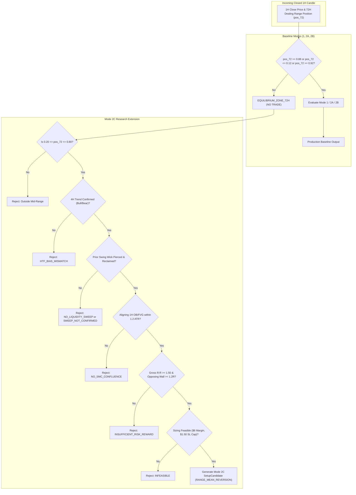

# Mode 2C Strategy Specification: Intraday SMC Mid-Range Liquidity Sweep

**Document Status:** Research Specification (Non-Production / Experimental)  
**Target Repository:** `SignalGenerator`  
**Author:** Quantitative Research  
**Date:** 2026-10-18  
**Reference Codebase:** [`src/strategy/research_mode2c.py`](file:///c:/Users/Administrator/Documents/SignalGenerator/src/strategy/research_mode2c.py)  

---

## 1. Executive Overview & Research Hypothesis

### The Problem in Production Baseline:
The production strategy relies on two primary dealing-range regimes:
1. **Mode 1 / Mode 2A (Extreme Zone Reversal):** Price in extreme premium ($\text{pos}_{72} \ge 0.88$) or extreme discount ($\text{pos}_{72} \le 0.12$).
2. **Mode 2B (Bull Expansion Breakout):** Price breaking out above $\text{pos}_{72} \ge 0.92$ with volume and variance-ratio expansion.

When the broader crypto market enters prolonged multi-week consolidations (as observed between late September and mid-October 2026), 100% of the watchlist oscillates in the middle 76% of their 72H dealing ranges ($0.12 < \text{pos}_{72} < 0.88$). Consequently, the scanner produces zero trade setups (`NO_TRADE`), and capital remains completely unutilized.

### The Mode 2C Research Hypothesis:
> *Can an intraday Smart Money Concepts (SMC) setup identify high-probability liquidity sweeps inside the dealing-range equilibrium zone ($0.20 \le \text{pos}_{72} \le 0.80$), capturing internal range liquidity rotations aligned with higher-timeframe trend without degrading overall portfolio net expectancy?*

### Non-Discretionary Guardrails:
1. **No Discretionary Heuristics:** Mere presence inside the mid-range or touch of an Order Block / FVG is strictly insufficient. Entry requires an identifiable prior structural swing, an audited wick sweep, and confirmed candle reclaim on closed bars.
2. **Strict Trend Alignment:** Setups must strictly align with closed 4H higher-timeframe market bias.
3. **No Lookahead:** All indicators, bias engines, swings, and confirmations operate strictly on closed candles at bar $t$.

---

## 2. Granular Deterministic Rules

### Rule 1: Higher-Timeframe (HTF) Directional Bias
- **Data Source:** Closed 4H candlesticks exclusively.
- **Evaluation Timestamp:** Evaluated strictly as of the candidate 1H candle's `close_time_ms` using `MultiTimeframeBiasEngine.calculate_4h_bias(candles_4h, as_of_timestamp_ms=current_candle.close_time_ms)`.
- **Directional Alignment:**
  - **Long Setups (Sell-Side Sweep):** Require `bias_4h == MarketBias.BULLISH`.
  - **Short Setups (Buy-Side Sweep):** Require `bias_4h == MarketBias.BEARISH`.
  - **Neutral or Conflicting Bias:** If `bias_4h == MarketBias.NEUTRAL` or conflicts with sweep direction, the bar is rejected immediately with reason code `HTF_BIAS_MISMATCH`.

### Rule 2: Defined Liquidity Sweep of Identifiable Prior Levels
- **Structural Swings:** Confirmed swing highs and swing lows detected via `detect_swings(sub_1h, swing_left=5, swing_right=2)`.
- **Confirmation Boundary:** Only historical swings where `swing.confirmed_timestamp_ms <= current_candle.timestamp_ms` are eligible.
- **Lookback Horizon:** Swings formed within the preceding 48 hours (`sweep_lookback_bars = 48`).
- **Equal Highs / Equal Lows (EQH / EQL):** Swings whose extreme prices are within $\pm 0.20 \times \text{ATR}$ are flagged as institutional liquidity pools.
- **Sweep Event Mechanics:**
  - **Sell-Side Sweep (Bullish):** A candle wick penetrates below an identifiable confirmed swing low:
    $$\text{Low}_{\text{bar}} < \text{SwingLow.price}$$
  - **Buy-Side Sweep (Bearish):** A candle wick penetrates above an identifiable confirmed swing high:
    $$\text{High}_{\text{bar}} > \text{SwingHigh.price}$$
- **Rejection Code:** If no swing was pierced within the recent 3-bar evaluation window: `NO_LIQUIDITY_SWEEP`.

### Rule 3: Sweep Confirmation and Reclaim (Closed 1H Candles Only)
- **Reclaim Requirement:** The sweeping candle or the immediate subsequent candle must close decisively back inside the structural level:
  - **For Long:** $\text{Close}_{\text{current}} > \text{SwingLow.price}$
  - **For Short:** $\text{Close}_{\text{current}} < \text{SwingHigh.price}$
- **Closing Momentum Confirmation:**
  - **Bullish Reclaim:** Current candle must close green ($\text{Close} > \text{Open}$) OR close above the sweeping candle's close.
  - **Bearish Reclaim:** Current candle must close red ($\text{Close} < \text{Open}$) OR close below the sweeping candle's close.
- **Rejection Code:** If price pierced the level but closed beyond it (a genuine breakout/continuation rather than a sweep): `SWEEP_NOT_CONFIRMED`.

### Rule 4: Dealing-Range Mid-Range Boundary Check
- Mode 2C is active exclusively when price is located in the mid-range of the 72H dealing range:
  $$0.20 \le \text{pos}_{72} \le 0.80$$
- If $\text{pos}_{72} < 0.20$ or $\text{pos}_{72} > 0.80$, price is in the outer discount/premium boundaries where Mode 1 and Mode 2A take precedence.
- **Rejection Code:** `EQUILIBRIUM_ZONE_72H` (if failing baseline) or `OUTSIDE_MID_RANGE`.

### Rule 5: Relevant 1H Order Block or Fair Value Gap Confluence
- **Institutional Footprint:** A sweep alone is not enough; price must have interacted with an institutional Order Block (OB) or Fair Value Gap (FVG).
- **Proximity Requirement:**
  - An active, unmitigated Bullish Order Block or Bullish FVG (for Longs) or Bearish Order Block / Bearish FVG (for Shorts) must be located within $1.20 \times \text{ATR}$ of the swept level:
    $$|\text{OB.price} - \text{SweptPrice}| \le 1.20 \times \text{ATR} \quad \text{OR} \quad \text{OB.low} \le \text{SweptPrice} \le \text{OB.high}$$
- **Rejection Code:** If a sweep occurs in empty space without aligning OB/FVG structure: `NO_SMC_CONFLUENCE`.

### Rule 6: Trade Levels, Risk:Reward, and Lifetime
- **Entry Price:** Current candle close $P_{\text{entry}} = \text{Close}_{\text{bar}}$ (simulated as limit order at bar close with $0.05\%$ penetration buffer).
- **Invalidation Level ($P_{\text{inv}}$):**
  - **Long:** Anchor to the lowest point of the sweep candle minus an ATR buffer:
    $$P_{\text{inv}} = \min(\text{Low}_{\text{sweep}}, \text{Low}_{\text{current}}) - (0.35 \times \text{ATR})$$
  - **Short:** Anchor to the highest point of the sweep candle plus an ATR buffer:
    $$P_{\text{inv}} = \max(\text{High}_{\text{sweep}}, \text{High}_{\text{current}}) + (0.35 \times \text{ATR})$$
- **Stop Loss ($P_{\text{sl}}$):** $P_{\text{inv}}$ buffered to ensure stop distance is bounded between $2.0\%$ and $2.4\%$ of entry price (fitting the $\$1.50$ loss limit on $\$6.00$ target margin).
- **Take Profit (TP1 & TP2):**
  - Target the opposing mid-range swing high/low or S&R zone.
  - TP1: Planned via structural swing or fallback $1.60\text{R}$.
  - TP2: $2.50\text{R}$ or opposing range boundary.
- **Opposing S&R Wall Clearance:** If an opposing Support or Resistance level is detected within $1.20\text{R}$ of entry:
  - **Rejection Code:** `INSUFFICIENT_RISK_REWARD`.
- **Order Lifetime / TTL:** 12 bars ($12$ hours). If unfilled within 12 bars, the order expires (`EXPIRED_NON_FILL`).
- **Pre-Fill Invalidation:** If price touches $P_{\text{sl}}$ before penetrating entry by $0.05\%$, the order is cancelled (`INVALIDATED_PRE_FILL`).

### Rule 7: Duplicate-Signal Suppression
- To prevent entering multiple trades on successive candles from the exact same sweep, the generator caches the unique signature:
  $$\text{Signature} = (\text{symbol}, \text{SweptSwing.timestamp\_ms})$$
- Once a swing point has generated an entry candidate, no further candidates referencing that same swing point may be generated.

### Rule 8: Explicit Rejection Reason Attribution
Every non-generating bar is assigned an explicit diagnostic reason code:
- `EQUILIBRIUM_ZONE_72H`: Price outside mid-range window $[0.20, 0.80]$.
- `NO_LIQUIDITY_SWEEP`: No confirmed swing pierced within 3 bars.
- `SWEEP_NOT_CONFIRMED`: Sweep pierced level but failed to close back inside or lacked closing momentum.
- `HTF_BIAS_MISMATCH`: 4H trend is NEUTRAL or directly opposes the sweep direction.
- `NO_SMC_CONFLUENCE`: No aligning 1H Order Block or Fair Value Gap within $1.2\text{R}$.
- `INSUFFICIENT_RISK_REWARD`: Gross R:R $< 1.50$ or opposing S&R wall within $1.2\text{R}$.
- `INFEASIBLE`: Position sizer cannot fit position within $\$1.50$ SL cap or exchange lot size limits.

---

## 3. Comparative Architecture: Baseline vs Mode 2C

---

## 4. Implementation Location & Isolation

- **Source Code:** [`src/strategy/research_mode2c.py`](file:///c:/Users/Administrator/Documents/SignalGenerator/src/strategy/research_mode2c.py)
- **Production Isolation:** The class `ResearchMode2CGenerator` is completely decoupled from `src/scheduler/runner.py` and `src/api/app.py`.
- **Production Integrity:** The active scanner continues to run `SetupGenerator()` with baseline thresholds (`0.12, 0.88, 0.92`), ensuring zero impact on the forward cohort.
