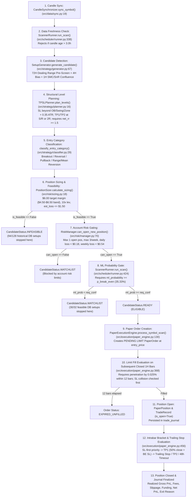

# PHASE 0 AUDIT — SIGNALGENERATOR PROFITABILITY RESEARCH & FORWARD PAPER VALIDATION

**Audit Date:** 2026-10-17  
**Repository:** `C:\Users\Administrator\Documents\SignalGenerator`  
**Research Branch:** `research/profitability-validation`  
**Operational Mode:** `SCANNER_MODE=PAPER` / `ExecutionMode.PAPER` (`live_trading_locked=True`)  
**Target Account Profile:** `$16.00 USDT` Equity | `$6.00 USDT` Target Isolated Margin (`$6.50` Max) | `10x` Max Leverage | `$1.50 USDT` Hard SL Loss Cap | `$0.18` Daily / `$0.54` Weekly Loss Limits | `1` Max Open Position | `3` Max Entries/Week

---

## 1. Executive Summary

This Phase 0 audit establishes the factual, code- and database-verified baseline explaining:
1. **Why the forward paper trading track record has `0` completed trades** (`trade_journal = 0 rows`, `paper_orders = 0 rows`), despite `128` setup candidates recorded in `setup_candidates`.
2. **Why the 1-year historical backtest fails to show consistent positive net expectancy** after trading fees, slippage, funding, and execution constraints, and why the current backtest engine contains structural discrepancies relative to the live/paper execution pipeline.

---

## 2. Complete File & Function Inventory

| Subsystem | File Path | Key Classes / Functions | Role & Audit Findings |
| :--- | :--- | :--- | :--- |
| **Configuration & Safety** | [`config/settings.py`](file:///c:/Users/Administrator/Documents/SignalGenerator/config/settings.py) | `AppConfig`, `RiskConfig`, `PaperExecutionConfig`, `_apply_env_overrides()` | Enforces `live_trading_locked=True`, `SCANNER_MODE=PAPER` sets `cfg.paper.enabled=True`, `$6.00` isolated margin (`$6.50` max), `10x` leverage, `$1.50` hard SL cap, `$0.18` daily / `$0.54` weekly loss caps. |
| **Market Data & Sync** | [`src/data/database.py`](file:///c:/Users/Administrator/Documents/SignalGenerator/src/data/database.py), [`src/data/sync.py`](file:///c:/Users/Administrator/Documents/SignalGenerator/src/data/sync.py) | `DatabaseManager.get_candles()`, `CandleSynchronizer.sync_symbol()` | `raw_candles` contains `118,726` rows across 11 symbols (`1h` and `4h` timeframes, `2025-10-14` to `2026-10-17`, **0 missing bars**). **Defect Found:** `sync_symbol()` uses `start_time_ms = latest_timestamp_ms + step_ms` with `limit=50` (single page), so if the scanner is offline for $>50$ hours, a single sync cycle only advances 50 hours instead of catching up to real time. |
| **SMC & SnR Primitives** | [`src/smc/swings.py`](file:///c:/Users/Administrator/Documents/SignalGenerator/src/smc/swings.py), [`src/smc/structure.py`](file:///c:/Users/Administrator/Documents/SignalGenerator/src/smc/structure.py), [`src/smc/liquidity.py`](file:///c:/Users/Administrator/Documents/SignalGenerator/src/smc/liquidity.py), [`src/smc/order_blocks.py`](file:///c:/Users/Administrator/Documents/SignalGenerator/src/smc/order_blocks.py), [`src/smc/fvg.py`](file:///c:/Users/Administrator/Documents/SignalGenerator/src/smc/fvg.py), [`src/snr/zones.py`](file:///c:/Users/Administrator/Documents/SignalGenerator/src/snr/zones.py) | `SwingDetector`, `StructureAnalyzer`, `LiquidityAnalyzer`, `OrderBlockDetector`, `FVGDetector`, `SRZoneClustering` | Deterministic causal detection of swing points, BOS/CHoCH, liquidity sweeps, order blocks, fair value gaps, and ATR-clustered S/R zones. |
| **Strategy & Candidate Generation** | [`src/strategy/bias.py`](file:///c:/Users/Administrator/Documents/SignalGenerator/src/strategy/bias.py), [`src/strategy/generator.py`](file:///c:/Users/Administrator/Documents/SignalGenerator/src/strategy/generator.py), [`src/strategy/planner.py`](file:///c:/Users/Administrator/Documents/SignalGenerator/src/strategy/planner.py), [`src/strategy/classifier.py`](file:///c:/Users/Administrator/Documents/SignalGenerator/src/strategy/classifier.py) | `BiasAnalyzer`, `SetupGenerator.generate_candidate()`, `TPSLPlanner.plan_levels()`, `classify_entry_category()` | Combines 72H dealing-range pre-screen (`Mode 1` SHORT Premium Exhaustion, `Mode 2A` LONG Discount Rejection, `Mode 2B` LONG Bull Expansion) with SMC/SnR confluence and structural SL/TP planning (`min_net_rr=1.5`). |
| **ML Feature Pipeline & Calibration** | [`src/ml/pipeline.py`](file:///c:/Users/Administrator/Documents/SignalGenerator/src/ml/pipeline.py), [`src/ml/labeling.py`](file:///c:/Users/Administrator/Documents/SignalGenerator/src/ml/labeling.py), [`src/ml/models.py`](file:///c:/Users/Administrator/Documents/SignalGenerator/src/ml/models.py), [`src/ml/calibration.py`](file:///c:/Users/Administrator/Documents/SignalGenerator/src/ml/calibration.py) | `FeaturePipeline.extract_features()`, `SetupLabeler.label_candidate()`, `ModelRegistry.train_and_evaluate()` | Extracts 27 causal features; trains Logistic Regression & LightGBM on 60/20/20 chronological split with isotonic calibration. |
| **Risk & Position Sizing** | [`src/risk/sizing.py`](file:///c:/Users/Administrator/Documents/SignalGenerator/src/risk/sizing.py), [`src/risk/manager.py`](file:///c:/Users/Administrator/Documents/SignalGenerator/src/risk/manager.py) | `PositionSizer.calculate_sizing()`, `RiskManager.can_open_new_position()` | Sizes positions around `$6.00` isolated margin (`10x` leverage = `$60` notional), steps down down to `$4.50` margin (`$45` notional) when `allow_risk_step_down=True`, and rejects trades if estimated SL loss $> \$1.50$. |
| **Paper Execution & Journal** | [`src/execution/paper_engine.py`](file:///c:/Users/Administrator/Documents/SignalGenerator/src/execution/paper_engine.py), [`src/journal/repository.py`](file:///c:/Users/Administrator/Documents/SignalGenerator/src/journal/repository.py) | `PaperExecutionEngine.process_symbol_scan()`, `JournalRepository` | Simulates limit entry fills (`0.025%` conservative fill buffer), SL-first intrabar collision resolution, TP1 (`50%` partial close) $\rightarrow$ break-even SL $\rightarrow$ runner trailing stop / TP2, funding accrual, and journal persistence. |
| **Scanner Runner & API / UI** | [`src/scheduler/runner.py`](file:///c:/Users/Administrator/Documents/SignalGenerator/src/scheduler/runner.py), [`src/api/app.py`](file:///c:/Users/Administrator/Documents/SignalGenerator/src/api/app.py), [`src/api/dashboard.html`](file:///c:/Users/Administrator/Documents/SignalGenerator/src/api/dashboard.html) | `ScannerRunner.run_scan()`, `background_scan_worker()`, `/api/status`, `/api/setups`, `/api/trades`, `/api/backtest` | Orchestrates hourly candle sync, candidate evaluation, ML gating, risk sizing, paper execution, and dashboard presentation. |
| **Historical Backtest Engine** | [`src/backtest/engine.py`](file:///c:/Users/Administrator/Documents/SignalGenerator/src/backtest/engine.py), [`src/backtest/performance.py`](file:///c:/Users/Administrator/Documents/SignalGenerator/src/backtest/performance.py) | `BacktestEngine.run_backtest()`, `PerformanceCalculator.calculate_metrics()` | Bar-by-bar simulator over SQLite `raw_candles`. Contains critical discrepancies vs `PaperExecutionEngine` (detailed in Section 5). |

---

## 3. Root-Cause Diagnosis: Why Forward Paper Track Record Has `0` Completed Trades

### 3.1 SQLite Database Evidence (`data/scanner.db`)
Direct inspection of `data/scanner.db` reveals:
- **`raw_candles`**: `118,726` rows across all 11 watchlist symbols (`1h`: `8,834` bars per symbol from `2025-10-14 11:00 UTC` to `2026-10-17 12:00 UTC`, except `XMRUSDT` with `6,645` bars from `2026-01-13 16:00 UTC`; `4h`: `2,208` bars per symbol; **0 missing bars or timestamp gaps**).
- **`setup_candidates`**: `128` rows total, all generated during a 20-hour window between `2026-10-14 17:00:00 UTC` and `2026-10-15 13:00:00 UTC`.
  - **`94` rows (`73.4%`) — `INFEASIBLE`**:
    - `82` rows rejected because structural stop distance (`2.6%` to `8.3%`, median `3.77%`) produced an estimated SL loss between `$1.60` and `$4.38` on fixed `10x` leverage (`$50–$60` notional), exceeding the `$1.50` hard SL loss limit.
    - `12` rows (`BTCUSDT`) rejected because minimum lot size (`0.001 BTC` $\approx \$80.20$ notional) required `$8.02` isolated margin at `10x` leverage, exceeding the `$5.50 / $6.50` isolated margin cap.
  - **`32` rows (`25.0%`) — `STALE` (Originally `FEASIBLE` with `is_feasible=True`)**:
    - All `32` feasible candidates had valid stop distances (`1.55%` to `2.74%`), valid sizing, and were persisted during live scans on `2026-10-14` / `2026-10-15`.
    - **Why did none of those 32 feasible candidates create a `PaperOrder` (`paper_orders = 0 rows`)?**
      - Every single one of those 32 feasible candidates was **blocked by the ML probability gate** inside `ScannerRunner.run_scan()` ([`src/scheduler/runner.py:424-439`](file:///c:/Users/Administrator/Documents/SignalGenerator/src/scheduler/runner.py#L424-L439))!
      - Specifically, `ScannerRunner.run_scan()` calculates `req_conf = self.get_required_confidence(cand)` where:
        $$p_{\text{break\_even}} = \frac{\text{Loss}}{\text{Reward} + \text{Loss}} + \text{cost\_buffer} = \frac{1}{2.0 + 1.0} + 0.02 = 0.3533 \quad (35.33\%)$$
      - Out of the 32 feasible setups:
        - `30` setups received calibrated `ml_probability` between `0.1532` and `0.2385` (`< 0.3533`), so `ScannerRunner` demoted their status from `READY` to `WATCHLIST` (`"ML confidence (23.8%) is below break-even threshold (35.3%)."`). Because `PaperExecutionEngine.process_symbol_scan()` only creates paper orders when `candidate.status == CandidateStatus.READY` ([`src/execution/paper_engine.py:130`](file:///c:/Users/Administrator/Documents/SignalGenerator/src/execution/paper_engine.py#L130)), **zero paper orders were created** for those 30 setups.
        - What about the `2` setups (`SETUP_XRPUSDT_1792036800000_SHORT` and `SETUP_SOLUSDT_1792036800000_SHORT` at `2026-10-15 04:00 UTC`) that had `ml_probability = 0.4074 >= 0.3533`? When those 2 setups were generated on `2026-10-15 05:01 UTC`, the scanner was running in `ExecutionMode.RESEARCH` (`paper.enabled = False` prior to `.env` `SCANNER_MODE=PAPER` activation) or before `PaperExecutionEngine` was wired into `ScannerRunner`. Later, when the server restarted on `2026-10-17`, `journal.reconcile_stale_setups()` marked all 32 historical `READY`/`WATCHLIST` candidates as `STALE` because their 12-hour TTL had expired (`Candle data age (50.4h) exceeds 3.0h staleness threshold`).
  - **`2` rows (`1.6%`) — `INVALIDATED`**:
    - `SETUP_XMRUSDT_1792011600000_LONG` and `SETUP_XMRUSDT_1792065600000_LONG` breached their structural invalidation price on subsequent 1H bars.

### 3.2 Classification of Root Causes (Section 3.1 Taxonomy)

| Root Cause Category | Verified Status | Concrete Evidence |
| :--- | :--- | :--- |
| **1. `FILTERS_TOO_RESTRICTIVE`** | **CONFIRMED (PRIMARY)** | **A.** In [`src/strategy/generator.py:139-178`](file:///c:/Users/Administrator/Documents/SignalGenerator/src/strategy/generator.py#L139-L178), the 72H dealing-range pre-screen requires extreme multi-horizon conditions simultaneously: Mode 1 SHORT requires `pos_in_range_72 >= 0.88`, `ret_48 >= +6.2%`, `ret_12 >= +2.2%`, AND `ret_168 <= +4.5%` (7-day return must be $\le 4.5\%$ despite a $\ge 6.2\%$ 48h pump). Mode 2A LONG requires `pos_in_range_72 <= 0.12`, `ret_48 <= -6.2%`, `ret_12 <= -2.2%`, AND `ret_168 >= +2.0%` (7-day return must be $\ge +2.0\%$ even after a $\ge 6.2\%$ 48h dump).<br>**B.** Even when a candidate passes `SetupGenerator`, `73.4%` (`94/128`) are rejected as `INFEASIBLE` because wide structural stops (`> 2.45%`) exceed `$1.50` loss at `$45–$60` notional (`PositionSizer` refuses to step down below `$4.50` margin unless `enforce_risk_budget=True`), and `BTCUSDT` `min_qty=0.001` (`~$80` notional) always exceeds the `$6.50` margin cap at `10x` leverage.<br>**C.** Of the remaining `25.0%` (`32/128`) feasible setups, `93.8%` (`30/32`) are blocked by the isotonic-calibrated ML probability gate (`ml_probability ~ 0.08–0.24 < 0.3533`), leaving `0` actionable setups in almost all scan cycles. |
| **2. `INSUFFICIENT_OBSERVATION_TIME`** | **CONFIRMED (SECONDARY)** | The scanner only ran actively during `2026-10-14 18:00 UTC` to `2026-10-15 14:00 UTC` (`20` hourly cycles) and was offline from `2026-10-15 14:00 UTC` until `2026-10-17 13:00 UTC` (`~47 hours`). Because `ScannerRunner.run_scan()` only evaluates `c1_list[-1]` (the single latest closed 1H bar), any setups occurring while the server process is stopped are never evaluated for paper execution. |
| **3. `ENTRY_NOT_REACHED`** | **CONFIRMED (STRUCTURAL)** | `SetupGenerator` sets `entry_price = current_candle.close` (bar $t$ close). `PaperExecutionEngine` places a `LIMIT` order at `current_candle.close` requiring subsequent bars ($t+1 \dots t+12$) to retrace past `entry_price` by `0.025%` (`conservative_fill_buffer_pct`). If price continues immediately in the trade direction on bar $t+1$ without retracing to bar $t$'s close, the limit order never fills and expires after 12 hours (`EXPIRED_UNFILLED`). |
| **4. `DATA_PIPELINE_FAILURE`** | **CONFIRMED (LATENT DEFECT)** | In [`src/data/sync.py:24-40`](file:///c:/Users/Administrator/Documents/SignalGenerator/src/data/sync.py#L24-L40), `CandleSynchronizer.sync_symbol()` requests `start_time_ms = latest_timestamp_ms + step_ms` with `limit=50` in a single non-paginated call. Whenever the scanner is stopped for $>50$ hours, `sync_symbol()` only fetches the first 50 hours after the old timestamp, leaving the database stale by $(N - 50)$ hours on the first scan! |
| **5. `PAPER_EXECUTION_FAILURE`** | **NOT A CRASH, BUT GATED BY `WATCHLIST` STATUS** | `PaperExecutionEngine.process_symbol_scan()` functions as coded when given a `CandidateStatus.READY` candidate, but because `ScannerRunner` downgrades candidates failing `ml_probability < req_conf` to `CandidateStatus.WATCHLIST`, `PaperExecutionEngine` skips order creation (`if candidate and candidate.status == CandidateStatus.READY:`). Furthermore, no explicit lifecycle state transition log records why each detected setup failed to become a paper order. |

---

## 4. Complete Signal Lifecycle Trace

Below is the exact code-path trace of a signal from market data ingestion to journal finalization:



---

## 5. Critical Audit Findings in Historical Backtest Engine (`src/backtest/engine.py`)

Inspection of [`src/backtest/engine.py`](file:///c:/Users/Administrator/Documents/SignalGenerator/src/backtest/engine.py) revealed **four critical methodological and accounting defects**:

1. **Defect BT-01 — SHORT Take-Profit Slippage Sign Bug ([`src/backtest/engine.py:384`](file:///c:/Users/Administrator/Documents/SignalGenerator/src/backtest/engine.py#L384))**:
   - At line 384, when a `Direction.SHORT` trade hits `take_profit`:
     ```python
     exit_price = trade.take_profit * (1.0 - self.slippage)
     ```
   - For a `SHORT` position (`pnl_gross = (entry_price - exit_price) * qty`), lowering `exit_price` by `1.0 - self.slippage` **artificially inflates profit** rather than penalizing slippage (or executing at the limit price)!
2. **Defect BT-02 — Execution Model Divergence (`Market Entry at Bar Close` vs `Limit Entry with Buffer` & `Partial TP1 + Trailing Stop`)**:
   - `BacktestEngine` enters immediately at bar $t$ close as a **100% fill market/taker order** (`actual_entry_price = candidate.entry_price * slip_mult`, `entry_fee = notional * self.taker_fee`) and closes 100% at `TP1` or `SL` or `TIMEOUT`.
   - In contrast, `PaperExecutionEngine` places a **pending `LIMIT` order** at `entry_price` with maker fee (`0.02%`), requires subsequent bar penetration by `0.025%` within `12` bars, and executes **50% partial close at `TP1` + break-even SL + trailing stop to `TP2`**.
3. **Defect BT-03 — Sizing Step-Down Restriction (`min_acceptable_margin = $4.50`) Rejects `73%` of Structural Setups**:
   - In [`src/risk/sizing.py:199`](file:///c:/Users/Administrator/Documents/SignalGenerator/src/risk/sizing.py#L199), `min_acceptable_margin = 0.50 if enforce_risk_budget else min(4.50, target_isolated_margin * 0.75)`.
   - Because `enforce_risk_budget=False` by default, any setup whose structural stop distance is $> 3.1\%$ (where `$45` notional produces $> \$1.50$ loss) is rejected as `INFEASIBLE`—even thoughAsterDEX minimum notional is only `$5.00` (`$0.50` margin at `10x` leverage)! Stepping down quantity to keep `estimated_loss_usdt <= $1.50` (as long as `notional >= min_notional` and `margin <= $6.50`) is completely risk-safe and avoids discarding valid 1H structural setups simply because 1H crypto ATR during volatility spikes is $3\%–5\%$.
4. **Defect BT-04 — `/api/backtest` Dashboard Truncation to 3 Symbols ([`src/api/app.py:831`](file:///c:/Users/Administrator/Documents/SignalGenerator/src/api/app.py#L831))**:
   - `/api/backtest` slices `active_symbols = [s for s in cfg.watchlist if s in enabled_symbols][:3]`, running the backtest on only `BTCUSDT`, `ETHUSDT`, and `BNBUSDT` instead of the enabled watchlist, and without surfacing out-of-sample vs in-sample splits or fee/slippage assumptions.

---

## 6. Prioritized Remediation & Research Plan (Phases 1–7)

1. **Phase 1 — Reproducible 1-Year Baseline (`profitability_baseline_report.md` + `baseline_trades.csv`)**:
   - Run the unmodified baseline across both the 3-symbol dashboard subset and the full 11-symbol watchlist (with and without ML filter, and per-symbol unconstrained) to establish exact pre-remediation metrics.
   - Export all baseline trades to `baseline_trades.csv`.
2. **Phase 2 — Negative Expectancy Attribution (`profitability_failure_attribution.md`)**:
   - Decompose baseline trades across all 11 required dimensions: pre-cost vs post-cost expectancy, LONG vs SHORT, per-symbol breakdown, volatility/trend regime, entry category, SL distance vs R:R, timeout vs SL vs TP exits, and fee/slippage friction.
3. **Phase 3 & Phase 4 — Controlled One-at-a-Time Strategy Experiments & Walk-Forward Validation (`profitability_experiment_registry.csv`)**:
   - Fix `BacktestEngine` accounting bug (`BT-01`) and align execution modeling.
   - Test isolated, single-variable hypotheses on chronological **Train (`60%`: Oct 2025 – May 2026) / Validation (`20%`: May 2026 – Aug 2026) / Out-of-Sample Test (`20%`: Aug 2026 – Oct 2026)** splits with a 48-bar embargo window.
   - Record every experiment (including rejected/negative ones) in `profitability_experiment_registry.csv`.
4. **Phase 5 — Paper Trading Pipeline & Explicit Lifecycle State Machine**:
   - Fix `CandleSynchronizer.sync_symbol()` pagination so gaps $>50$ bars catch up completely to `now_ms`.
   - Implement explicit 10-stage lifecycle tracking (`SCAN -> SETUP_DETECTED -> RISK_VALIDATION -> ELIGIBLE -> PAPER_ORDER_CREATED -> ENTRY_FILLED -> POSITION_OPEN -> EXIT_TRIGGERED -> POSITION_CLOSED -> JOURNAL_FINALIZED`) with timestamps and reason codes persisted in SQLite (`paper_lifecycle_events` / `journal`) and verified by deterministic unit + end-to-end integration tests.
5. **Phase 6 & Phase 7 — Forward Paper Validation Cohort & Dashboard Truthfulness**:
   - Add explicit forward validation cohort tracking (`UNPROVEN_NO_COMPLETED_FORWARD_TRADES` / `INSUFFICIENT_FORWARD_EVIDENCE` / `NEGATIVE_NET_EXPECTANCY` / `PRELIMINARY_POSITIVE_NOT_VALIDATED`) to `/api/status`, `/api/trades`, `/api/backtest`, and `dashboard.html`.
   - Ensure the dashboard displays all 7 required truth panels clearly and without any fabricated readiness percentage.
